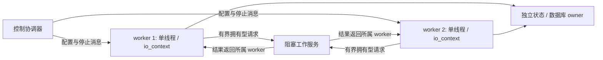

# 并发与多线程架构

状态：架构选择与分阶段实现；Linux 代理已支持有限多 worker，覆盖范围与限制见下。目标是多核处理大量独立连接，同时保留路由、背压、取消和资源上限。不存在脱离负载、平台与测量的绝对最优架构；首选方案是**按连接/流分片的单线程事件循环，加独立的有界阻塞工作服务**，在实际基准证明瓶颈后再调整。

## 为什么这样分工

| 方案 | 好处 | 对 Nexus 的主要代价 | 决定 |
| --- | --- | --- | --- |
| 一个事件循环，多线程同时执行 | 调度灵活、共享缓存容易 | socket、会话、TLS、协议状态、计时器和取消均需串行化或锁；单个热对象易争用 | 不作为首版 |
| 每 worker 独立事件循环，连接固定归属 | 热路径局部化，沿用已有单 owner 状态机，故障和预算可分片 | 接入分发、全局资源限额、跨分片缓存/状态与停止更复杂；热点流可能不均 | 首版候选 |
| 每连接一个线程 | 实现模型直观 | 大量空闲连接的栈、调度和内存成本 | 不采用 |

当前固定 Corosio 版本的 `io_context` 默认支持共享线程，但其 `tcp_socket` 文档不允许同类操作并发；一个读和一个写可同时在途。线程安全的 context 不会自动保护 Nexus 的 `Session`、TLS、路由或取消逻辑。项目当前 `Server` 单线程驱动，不能简单增加同时调用 `poll` 或 `run` 的线程。固定版本源码见 [io_context](https://github.com/cppalliance/corosio/blob/70adbd5aff90569aac588e78a717fecbd5b7dedc/include/boost/corosio/io_context.hpp) 和 [tcp_socket](https://github.com/cppalliance/corosio/blob/70adbd5aff90569aac588e78a717fecbd5b7dedc/include/boost/corosio/tcp_socket.hpp)。

## 所有权与调度

- 每个 worker 有一个线程、一个 Corosio `io_context`、本地计时和会话集合；一个连接的 socket、两方向协程、TLS、HTTP/协议状态和取消操作始终由该 worker 串行驱动。协程可有多个在途 I/O，但不能据此假定状态可从其他线程访问。先保留默认安全锁配置；任何 lockless 配置需证明后台投递与后端满足其约束。
- 接入时一次性确定连接归属，存活期间不迁移。每个 worker 内确保每轮处理预算与公平性；单个大流不能占满整个 worker。网络 worker 数可配置，当前默认 `1`；单 worker 继续由调用方线程驱动事件循环，不额外创建网络 worker 线程。显式 `1` 与单核环境适用同一条路径，不因检测到单核而静默更改用户配置。系统 DNS 等阻塞任务仍可能按需启动独立后台线程，不能把一个网络 worker 等同于整个进程只有一个线程；io_uring 等内核后端也可能使用内核工作线程。自动模式（`"auto"` / `"max"` / `"max-N"` / `max=M`）按宿主可用并发度动态计算上限（Linux 下优先参考 CPU 亲和性集），避免超出实际可用核数。
- 跨线程只传拥有所有权的消息或稳定只读快照，不传借用视图、socket 引用、协程帧地址或未受保护的可变状态。消息队列按项数和字节有界，有明确满队列、唤醒、关闭和丢弃语义；唤醒不能丢失，消费者退出前必须排空或明确拒绝。后台完成使用 worker/任务 ID 与代次检查，关闭后迟到结果不能访问已销毁对象。实际投递 API 和可跨线程关闭的行为以固定 Corosio 版本实测为准。
- CPU 重计算、同步文件、系统 DNS 和数据库不能阻塞网络 worker。前者由有界工作服务承接，数据库由专门 owner 串行访问。系统 `getaddrinfo` 不能保证可中断：取消等待不表示任务已经停止，其配额、内存及 worker 服务必须存活至真正完成；全局线程和队列上限不能随网络 worker 数线性无界增长。Corosio 当前 resolver 使用 context 的线程池，多个 context 的线程数和生命周期必须测量并受总预算约束，不能假定天然共享。

固定 Corosio 版本在 POSIX 下的阻塞线程池按 `io_context` 分配，默认一个线程，首次提交工作时启动；`io_context_options::thread_pool_size` 最小为 1，常规 resolver 和部分文件 I/O 共享该 context 的池。GCC 16/Linux epoll 的受控 `getaddrinfo` 门闩测试使用三个 context、每个三个请求：默认设置下同时有三个调用进入，设置每池两个线程后同时有六个进入，所有请求释放后完成。测试证明此场景下的调用并发，不证明线程创建失败、取消、公平性或跨 context 共享池能力。由此推论：不能直接为每个网络 worker 默认启用系统 resolver 并声称存在独立于 worker 数的全局线程预算；必须设计集中式解析服务，或明确将各 context 池计入总预算并限制 worker 数。

Mixed 会话持有 stop source，关闭时请求停止并关闭各 I/O owner；握手、HTTP 上传/排空和两方向转发共享停止令牌。转发使用 Capy `quitter`，正常完成由回调计数，异常或停止回调关闭会话；每个任务持有共享会话直至完成。单、双 worker 的活跃 SOCKS 转发停止回归验证两端关闭和重启，半关闭、HTTP 上传及经 VLESS 互通对端的 Mixed 转发回归通过。VLESS/SS 入站的两个转发子任务使用同一停止令牌和 `quitter`，各自完成或停止时由回调计数；父协程不绑定该令牌，等待子任务排空后才释放借用的连接对象。VLESS 真实连接停止、异常注入、链式出站、背压和半关闭，以及 SS 单/双 worker 互通、活动连接停止和半关闭已验证。VLESS/SS 出站连接各自拥有停止源，连接阶段通过 `quitter` 传播停止；传输入口检查停止状态，取消仍显式通知 resolver、socket 和 relay。 代理直连候选现在共享会话启动后的 10 秒绝对连接 deadline；deadline 通过 Corosio timeout 取消挂起 connect，并在超时或错误后关闭目标 socket。真实 VLESS 挂起 TLS 握手后停止不再尝试后续候选，SS 的 DNS 超时和活动会话停止互通通过。受控系统解析器测试对 VLESS 和 SS 出站分别验证单、双 worker：会话超时后其他握手仍可进行，停止等待阻塞解析返回再完成。系统 resolver 的阻塞调用仍可能延迟停止。

固定版本的初步实测：`nexus-io-threads-test` 在 GCC 16、Linux 的 epoll 和 io_uring 下，通过四个生产线程向一个持有 work guard 的 worker 投递 1000 个独立协程，验证全部执行且运行于该 context；还验证空闲机会后的跨线程唤醒、释放 guard 后排空，以及 `stop()` 保留队列、`restart()` 后执行。io_uring 在沙箱外运行。测试使用裸 coroutine handle 的一次性独立任务，不覆盖被其他协程等待的 continuation、生产队列、resolver、投递与销毁竞态或所有调度交错；`stop()` 不是排空完成信号。

当前单 worker 路径在 GCC 16/Linux io_uring 下经过单 CPU 亲和性测试：启动、一次 `poll` 和停止前后，`/proc/self/task` 中的用户态线程数没有增加。该测试没有启动 DNS、连接或其他后台任务，不能推断整个进程在所有工作负载下始终单线程；多 worker 尚未实现。

Linux 代理主配置顶层 `workers` 缺省为 `1`，并支持显式整数（上限随宿主可用并行度动态确定，移除旧的硬编码 `1..16` 限制）、`"auto"`、`"max"`、`"max-N"` 及可选上限属性 `max=M`。多 worker 为每个线程构建独立 context、`SO_REUSEPORT` 监听器与动态每 worker 出站表，共享全局会话配额；规则和认证配置在启动前复制，公开控制方法由一个协调线程调用。worker 发生未预期退出时停止其他 worker 并通过 `healthy()` 通知 CLI，CLI 报错退出；停止会等待每个 worker 完成取消并 join。系统解析池仍是每 context 一份，线程数随 worker 数增加；当前尚无独立于 worker 数的全局解析池。多 worker VLESS 共享不可变的启动快照，每条隧道拥有快照引用并创建独立 TLS 状态。全仓当前统一以 Clang（`llvm@23.1.6`）+ 静态 `libc++` 在 `epoll` / `io_uring` 下持续回归覆盖多 worker SOCKS/Mixed/HTTP/VLESS/SS-2022 并发转发、会话配额回收、握手期限、端口冲突重试、启动中途故障回滚与热重载。

Linux 监听器通过 Corosio 公开的原生句柄设置 `SO_REUSEPORT`，系统调用错误直接经 `expected` 返回。第二个 worker 的选项设置注入 `EACCES` 时，错误码正确返回，资源回到基线，同一服务器对象与端口可重启并完成 SOCKS 握手。

监听运行中收到 `ECONNABORTED` 时重新接受连接，其他 accept 错误仍报告 worker 故障。GCC 16/io_uring 单、双 worker 注入一次该错误后服务保持健康、后续 SOCKS 协商成功；单、双 worker 注入 `EIO` 则报告故障并在停止后恢复资源。双 worker 测试不保证后续连接分配到发生故障的同一 worker。

每个服务器实例保存首个报告的运行期故障类型及可用的原始系统错误码，跨 worker 通过互斥锁发布，不依赖共享的进程级最后错误。记录在停止后保留，下次有效启动时清除；故障类型的固定描述不分配，CLI 需要系统消息时才格式化。GCC 16/io_uring 在单、双 worker 注入 accept `EIO`，验证类型、系统码、停止保留、重启清除及 CLI 输出；同时发生多个故障时以先取得锁的报告为准。双 worker 屏障同步注入 `EIO` 和 `ENOSPC` 的 20 次回归验证了读取的错误在停止后不变、资源回收与重启；测试未独立测量抢锁顺序，也不是长期高负载测试。

## 监听、流归属与共享状态

Linux TCP 首个多 worker 原型优先评估每 worker 一个 `SO_REUSEPORT` 监听 socket，由内核分发新连接；这是候选而非已验证的最终选择。须继续验证启动/关闭和失败回滚语义；如无法满足则评估单 listener 接受后安全移交原生 FD；不得跨 context 移动已登记的 Corosio socket 而没有明确支持。`port=0` 时首个绑定确定端口，其他 worker 加入同一端口，任一步失败必须撤销全部监听并报告失败；不同平台分别选择可验证的接入方式。Linux 允许多个同端口 socket 使用 `SO_REUSEPORT`，不保证所有工作负载均匀或延迟最优：[socket(7)](https://man7.org/linux/man-pages/man7/socket.7.html)。

固定 Corosio 的 `tcp_acceptor::set_option(socket_option::reuse_port(true))` 可在绑定前设置该选项。GCC 16/Linux 本地测试以首个监听器绑定端口 0，再将第二个独立 context 绑定到所分配的同一端口；epoll 和 io_uring 各完成 128 次顺序 TCP 连接、返回 worker 标记，并由各 owner 关闭监听器和排空 accept。两次样本均观察到两个 worker 收到连接，不保证公平性或负载下的分布。尚未验证启动中途失败回滚、代理会话、并发背压或完整生产停机。

TUN、UDP、QUIC 和 FakeIP 不能简单套用 TCP 连接接入：每个有状态流的报文和回包必须路由到相同 owner，分片键与 NAT、映射、回包过滤及重绑定语义一致；队列重排、丢包、worker 退出及分片数变化需单独设计。FakeIP 地址分配和持久状态需要全局唯一 owner 或已证明的分区规则，不能使用各 worker 独立分配池。

DNS 首版可每 worker 持有自己的 `AddressCache` 和在途登记，避免热路径共享锁；这是分片内合并，不保证跨 worker 去重。总内存、查询与上游并发须受全局预算约束，不能将现有 4096 上限无条件乘以 worker 数。每个 worker 使用同一版本化视图语义；策略变更/清空由协调器向所有 worker 发送屏障，完成回执之前不能声称全局清空已完成。旧查询以代次失效，工作线程失败或停止时清空命令必须返回失败或不完整，不能报告成功。未来若上游放大或缓存重复成为瓶颈，再实测按完整 DNS 键路由至专用分片的消息开销与全局去重收益。

配置和规则先完整校验、编译成不可变快照，再发布；会话持有其快照至所有借用和协程结束。首版定义新会话获得哪个已提交代次，旧会话保持原代；跨 worker 的发布、确认、失败回滚和清空屏障需提供可观测的统一结果。避免把多个线程各自更新指针误称为全局瞬时原子切换；配置、密钥快照的代数及内存重叠要有预算。权威共享状态采用专门 owner，普通统计尽量本地计数后汇总；日志与数据库按各自文档使用有界队列。

## 限额、生命周期与停机

连接、FD、请求、缓存字节、队列、线程和后台任务同时设置总预算与必要的分片预算。连接上限是进程总量，采用可审计的全局 reservation 并在会话及其异步任务真正结束后释放；队列满、抢占失败和 worker 不均时不得超过总量，也不得静默丢失已接受的连接。分片固定配额会产生空闲容量无法借用，是否批量借用须测量并验证上限。

协调器先停止接纳并阻止新任务，再向所有 owner 发取消/关闭，等待网络协程、后台结果与资源回收；最后停止事件循环、join worker，再销毁 context 和共享状态。阻塞系统调用无法取消时，不承诺固定时间内完全退出；如需有界退出，必须另行定义进程级策略而非提前销毁仍被访问的对象。启动中途失败须按相反顺序回滚；工作线程异常须汇报协调器、停止受影响服务并完成资源回收，不能无声退出。

代理使用可共享的 `SessionQuota` 租约管理 64 个会话额度：原子计数限制成功预留数，租约随会话最后一个 owner 及其资源释放，跨线程争用测试覆盖上限、移动和释放；多 worker 共享同一个进程内 quota。GCC 16 epoll 和 io_uring 下既有并发转发、64 会话、超额拒绝和回收测试通过。此前 io_uring 测试失败时，系统调用跟踪观察到测试客户端的 connect/recv 返回 EINTR；测试现处理 EINTR 和短读后回归通过。这解释了跟踪到的失败，不能证明所有此前失败均同因或覆盖所有 io_uring 竞态。

代理分离启动的 accept、握手、转发和 HTTP 上传/排空任务配置显式异常回调：会话任务异常关闭会话，accept 任务异常使该 worker 退出；避免 Capy 默认异常处理终止进程。回调与会话都由所属 worker 驱动，其他在途协程持有会话直至取消完成。GCC 16/io_uring 双 worker 注入一次 accept `EIO`，验证 `healthy()` 报故障、停止后 FD/线程恢复及同端口重启；SOCKS 配额、Mixed 和 HTTP 上传回归通过。独立 Capy/Corosio 测试在 epoll 和 io_uring 下令分离协程抛出 `std::runtime_error`，验证错误回调在所属 context 运行且其他任务仍完成。测试专用构建在监听成功、设置运行状态后、启动 accept 协程前抛异常，验证单 worker 与第二个 worker 的回滚、同端口重启及 SOCKS 握手；这验证项目异常回滚路径，并不模拟第三方启动内部的异常。同一测试构建还在读取首字节后的握手协程内抛异常：单、双 worker 下连续 70 个失败会话均关闭，预先进入握手的另一会话仍能完成认证协商，服务保持健康，停止后 FD/线程回到基线；双 worker 不保证会话分布到不同 worker。尚未在 accept、转发或 HTTP 协程内直接注入异常，也未覆盖启动时分配失败和其他竞态。

## 验证和迁移顺序

1. 固定 Clang（`llvm@23.1.6`）、静态 `libc++`、Corosio（`0.3.13`）版本和后端，维护单 worker 端到端及资源基线；验证每 worker context 的跨线程投递、唤醒、停止、resolver 线程与销毁契约，不提前假设线程安全。
2. 实现 worker 生命周期、监听及全局配额，保持 `1` worker 由调用方驱动、默认配置与现有行为兼容；验证单核亲和性、单 worker 无额外网络线程、启动失败回滚、端口冲突、并发接入上限、空闲与满负载停止、迟到完成、慢系统解析和 FD/线程回收。
3. 在多个 worker 重跑 SOCKS、Mixed、HTTP、VLESS 的顺序、半关闭、背压、超时及错误回归；使用混合大小流，检查每 worker 负载、队列满和公平性。
4. 验证 DNS 分片隔离、全局清空确认、清空期间旧查询及 worker 失败；为 TUN/UDP 和持久权威状态分别设计并验证归属。
5. 比较 1/2/4 等 worker、CPU 配额和不同连接分布，交错重复并记录吞吐、P50/P99、CPU、RSS、线程/FD、拒绝率及停机时间；同等正确性与总预算下再选默认值。见 [验证体系与实机基线](../planning/validation.md#4-性能验证准则与-linux-实机基线)。可使用数据竞争检测，但固定模块工具链和第三方代码可能需要独立可运行的构建，检测通过不能替代生命周期与协议测试。
