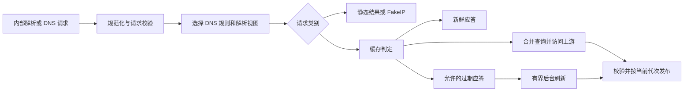

# DNS、DNS 缓存与乐观缓存

状态：内部地址解析、多视图共享缓存、在途合并、乐观刷新、持久化与有序 DNS 规则已接入生产；核心设计原则见 [路由、DNS 与状态原则](../design-principles/routing-dns-and-state.md)。

Fake-IP 地址分配、安全复用、崩溃恢复与有界嗅探的细化约束见[Fake-IP 专题](dns-fakeip-engine.md)；配置示意中的本地 DNS 监听不自动修改宿主 DNS，见[配置规范](../configuration/spec.md)。

当前 local 解析由进程级后台线程每秒读取 `/etc/hosts` 和 `/etc/resolv.conf` 的有界快照；正在运行的查询保留开始时的版本，新查询使用最新版本。数字地址与 hosts 优先，其余名称向快照中的 nameserver 发起可取消的异步 UDP/TCP 查询。代理目标、出站服务器、DNS bootstrap、Reality cover 和 Shadowsocks UDP 入站使用该路径，Nexus 源码不再调用 Corosio 系统 resolver。支持最多六个搜索域和 `ndots` 查询顺序，末尾带点的名称只查询绝对名称；仅名称不存在或无地址时继续下一个候选，传输或服务器故障不触发搜索回退。文件读取或解析失败时发布空快照，随后自动重试；尚未实现 mDNS 或 systemd-resolved 分域配置，也不会自动改用公网 DNS。两个文件分别读取，因此它们的同时修改不构成原子事务；普通文件上的读取若由底层文件系统阻塞，后台线程退出也可能等待该读取。此行为不等同于完整 libc/NSS 或 systemd-resolved 语义。

## 当前报文实验

`nexus.dns.message` 构造单问题的递归查询，并解析最多 4096 字节、128 条资源记录的响应，检查事务 ID、QR、opcode、单问题及大小写不敏感的问题名称、类型和类别；TC 响应作为截断拒绝。名称压缩仅接受已验证的更早名称边界并限制解码工作量；问题、记录 owner 及 CNAME、NS、PTR、MX、SOA 数据中的名称会登记边界。其他 RDATA 内的名称尚不登记，因此引用这些位置的合法报文可能被保守拒绝。记录保留完整报文和 RDATA 偏移，防止压缩指针脱离原报文。名称输入与解码目前限制为不含点、反斜杠和控制字符的可打印 ASCII 标签，不覆盖任意二进制 DNS 名称。基础格式依据 [RFC 1035](https://www.rfc-editor.org/rfc/rfc1035)。

地址提取支持 NOERROR 的 IN A/AAAA，沿 answer 段的 CNAME 追踪最多 16 个名称，拒绝循环、冲突的别名、同名同类目标地址与别名共存、畸形地址或别名数据；返回地址及该链和地址 RRset 的最短 TTL。没有地址时只报告空结果及最后名称，不能据此推断 NXDOMAIN/NODATA 或负缓存期限；TTL 为零也不得复用。其他 RCODE 不作为地址结果；OPT 仅在调用方允许且满足支持的 EDNS 约束时接受。

报文层可构造不带选项的 EDNS(0) 查询，检查响应 OPT 的位置、唯一性、根名称和选项长度，提取版本、标志及完整 12 位 RCODE；OPT 不当作普通数据缓存。依据 [RFC 6891](https://datatracker.ietf.org/doc/html/rfc6891)。显式上游可配置无选项 EDNS(0)，通告 1232 字节；无 OPT 的 FORMERR 触发重新抽取事务 ID 并重试普通 DNS，保留原期限。只接受版本 0、无标志及无选项的响应，其他选项语义尚不支持。

外围解析只检查上述已支持的名称数据和 EDNS 选项 framing，不验证任意 RDATA、选项内容或 DNSSEC；提取结果不是已认证地址。调用方必须提供不可预测的事务 ID 并验证响应的来源地址和端口；这些检查及后续关联约束须按 [RFC 5452](https://www.rfc-editor.org/rfc/rfc5452) 接入传输后验证。GCC 16 测试覆盖固定样本、逐字节截断、问题失配、名称大小写、错误指针、已验证边界和记录上限，以及 A/AAAA、别名链、TTL、无关地址与畸形记录。

私有 `dns::detail::UdpQuery` 进行一次异步 UDP 查询：调用方提供数值上游、不可预测事务 ID 与统一绝对期限，使用独立 socket 的本地临时端口，并检查响应源地址、端口、事务和问题；最多处理 32 个数据报，超过上限报错。完整匹配的 TC 响应可通过私有 `FallbackQuery` 在同一绝对期限内连接同一上游 TCP，按两字节长度分帧并限制响应为 4096 字节；TCP 响应仍需匹配事务和问题。可取消，owner 必须保留对象直到协程完成；不支持共享 socket、其他重试、缓存或后台任务。GCC 16/io_uring 下受控回环对端验证伪造来源、错误事务、问题不匹配的 TC、有效回复、匹配截断、32 包上限、超时和取消；TCP 回退另由 Python 回环对端验证分片、错误 ID、超长帧、断开、共享期限和取消；不代表已验证真实 DNS 服务器、随机 ID 生成或所有取消竞态。

私有 `AddressResolver` 在单个上游和绝对期限内继续查询跨响应 CNAME，限制整个链最多 16 个名称并检测跨响应循环；每次查询从 Linux `getrandom(GRND_NONBLOCK)` 获取新的随机事务 ID，随机源未就绪或出错时直接失败。返回 TTL 按链和地址的最小值保守扣除整个解析耗时；空答案不作为负缓存。地址解析区分 NXDOMAIN、SERVFAIL、REFUSED，以及有覆盖该名称的 authority SOA 时的 NODATA；只有 NS 的转介和无充分依据的空响应分别报转介与不确定，不按可缓存否定答案处理。报文层可从覆盖目标的最具体 authority SOA 取 SOA TTL 与 MINIMUM 的较小值，零值保留；同一最具体区域多个 SOA 时保守取最小值。该计算本身不验证否定语义、真实性或施加本地上限；NODATA 分类复用覆盖判断；同一响应的 CNAME 链无地址且终点有覆盖 SOA 时直接判为 NODATA，否则继续查询终点。NXDOMAIN 和有 SOA 依据的 NODATA 的 answer 仅接受经校验的 CNAME 链；其他 answer 记录会保守地作为协议错误拒绝，包括目前不支持的 DNSSEC 记录。否定 TTL 受链及终点 SOA 限制；负结果不向调用方暴露规范名。EDNS 的支持范围见上文。受控回环测试覆盖跨响应别名、循环、随机源失败和取消；GCC 16/io_uring 使用本地隔离 dnsmasq 2.93 验证 A、AAAA、CNAME 和 NXDOMAIN 不作为成功地址；NXDOMAIN 返回独立的名称不存在结果，具备有效 SOA 依据时可由组合器缓存。该解析器已通过组合器接入显式上游；空结果、错误及 DNSSEC 不具备完整解析器语义。

私有 `DualAddressResolver` 顺序组合 A 和 AAAA，使用同一绝对期限与按类型区分的缓存；单族 NODATA 允许另一族成功，其余故障不返回部分地址。两个成功答案的规范名称不一致、前一个答案表明名称存在而后一个为 NXDOMAIN，以及超过 64 个地址时拒绝。两个 NODATA 返回 NODATA；当前负结果不携带规范名，无法比较其别名链。该组合器已接入显式上游的代理目标解析；未实现并行查询或地址连接竞速。

## 配置参考

DNS 服务器配置采用带类型和 tag 的服务器列表、规则与默认服务器模型并映射为 KDL：区分 `local` 与携带地址的远程服务器，未指定默认 tag 时选首个服务器，拒绝重复 tag、缺失依赖和服务器依赖环；UDP 传输默认端口 53，截断（TC）后在同一上下文中回退 TCP；远程服务器的域名引导与出口依赖显式建模，避免解析自身形成循环。

服务器组、引导引用及顺序回退需在校验期检查缺失与环路，消息交换在传入 deadline 时贯穿多个服务器。地址解析遇到空结果不默认继续回退至其他视图，避免将有效否定结果扩散至其他解析视图。

现有 KDL `dns` 块支持命名 `local`、`udp`、`tcp`、`tls`、`https`、`quic` 服务器、域名/后缀与 `query-type` 的有序选择、`final` 和显式多级域名引导。具名物理上游可绑定接口。A/AAAA 在各自类型下选服务器，分流后仍检查规范名、正负答复一致性与 64 地址上限。local 的 hosts、搜索候选及快照跨两个问题保持一致；bootstrap 沿显式依赖解析。DoT 使用连接级事务登记，DoQ/DoH3 使用独立流，按配置与实际端点复用。默认共享缓存以实际服务器 profile、endpoint、代次 view 与 qtype 隔离，local 的不可变配置快照也是 view 身份的一部分；按类型逐项实现和验证，不静默接受未实现字段。

## 职责与处理链路

DNS 子系统同时面向应用内部的地址解析，以及可选的客户端 DNS 消息服务。前者返回地址与有效期/来源信息，后者需要保留 RCODE、CNAME、authority、EDNS 和消息边界；不能将两者统一成只返回 IP 数组的接口。

解析视图至少描述上游身份、出口/接口、DNS 规则与响应变换、ECS、系统网络环境及信任策略。先确定视图再查缓存，命中不能跳过当前的路由约束和响应过滤。静态记录与 FakeIP 有独立状态模型，不混入普通上游 TTL 缓存。

DNS 上游传输通过能力接口装配，具体支持 UDP、TCP、加密传输或系统解析的范围分阶段决定。加密 DNS 使用既定自研 TLS/证书边界；本轮不引入另一套 TLS 依赖。地址查询支持 A/AAAA 策略，但地址排序、DNS 查询并发和连接竞速是不同策略，不能因“优先 IPv6”就默认只请求 AAAA。

## 引导、出口与回环

上游 hostname、代理节点 hostname 和普通业务域名分别声明解析依赖。bootstrap 必须有不依赖自身的解析路径；配置期检查显式依赖环，运行时携带查询链上下文与深度/时间上限，拒绝递归回环。

DNS 连接遵循出口路由和 TUN 绕行规则。使用系统 DNS 可能导致再次进入 Nexus，调用 systemd-resolved 也不自动消除回环。内网/split DNS、链路域和 VPN 网络变化需形成可观察的视图切换，不能默默改用公网解析器。

从请求进入开始使用共同 deadline，覆盖队列、引导、连接、重试与 fallback；每次重试不重新获得完整超时。明确哪些错误可转用其他上游。有效 NXDOMAIN/NODATA 不是网络错误，默认不因答案为空就向不同信任域继续查询。上游并行竞速可能扩散域名查询，只在显式策略下启用。

当前独立的 `nexus.dns.cache` 是单 owner 正地址缓存实验，已与私有解析器组合并接入显式上游：仅保存 A/AAAA，按视图 ID、规范化名称和类型分键，容量最多 4096 条，按最早到期淘汰；调用方提供经验证且通过策略的答案及剩余 TTL。TTL 按单调毫秒保守递减，剩余不足一秒提前失效，零 TTL 删除旧项，清空令此前查询失效。每次外部查询前按完整键登记令牌，最多 4096 个待处理查询；成功发布或确定的 NXDOMAIN/NODATA 失效操作会使同键更早令牌失效，避免旧结果在更新、删除、过期或淘汰后复活，不影响不同键；有终点覆盖 SOA 依据的否定结果可按期限缓存，缺少依据时只建立屏障。查询失败或取消时 owner 须调用 `cancel_query` 回收登记；清空也回收全部登记。令牌仅用于产生它的实例和登记时的键，不可重复使用。缓存不验证策略或视图身份：owner 必须给语义不同的视图分配不同 ID，策略改变时清空，并在旧条目和查询消失前不复用 ID；不得并发调用。支持有覆盖终点 SOA 的 NXDOMAIN/NODATA，包括经校验的同包或跨响应 CNAME 链，按完整查询键保存并与正条目共用容量和发布屏障；否定 TTL 限于 CNAME 链最短 TTL 和 SOA 期限，扣除解析耗时并限于 600 秒，零 TTL 不保存；其他错误不缓存。无持久化或乐观刷新。GCC 16 单元测试覆盖期限、视图、清空、逆序发布、零 TTL、取消、容量及淘汰屏障。

私有 `CachedAddressResolver` 将上述缓存与单次 `AddressResolver` 组合：命中直接返回，未命中时登记查询并解析，成功或有终点覆盖 SOA 依据的否定结果才尝试发布；临时失败、取消、清空或登记满不会把失败结果写入缓存。缓存登记和发布失败不影响成功的解析结果，登记通过作用域回收。每个操作及缓存由同一执行器拥有并持续到协程完成；调用方负责确保上游、视图和响应满足缓存策略。GCC 16 受控回环验证命中不发包、视图隔离、清空后重查、无 SOA 的 NXDOMAIN 不缓存，有 SOA 的直接及 CNAME 链 NXDOMAIN/NODATA 命中缓存，取消后登记容量全部回收，以及较新 NXDOMAIN/NODATA 在较早正应答前完成时阻止后者写入缓存、SERVFAIL 不触发该屏障；该组合已接入显式上游配置；尚未验证所有并发取消竞态。

## 缓存键与消息所有权

建议缓存键包含规范化 QNAME、QTYPE、QCLASS 和解析视图身份。DNS 名称按协议处理大小写与根标签；IDNA 转换属于文本入口策略，不对任意 wire label 做 Unicode 重写。ECS 纳入有效前缀及作用域处理，不能把不同客户端子网的应答直接共享。

DO/CD 等验证语义、响应变换和策略依赖必须进入键/视图，或在首期对这些请求绕过缓存。多 question、未知 EDNS 语义、TSIG、更新/区域传送及无法正确重放的请求默认不缓存、不合并。不能让未缓存请求悄悄进入仅按简单问题索引的在途表。

事务 ID、客户端 UDP 长度、TCP 分帧和请求方特有字段不作为可复用结果的一部分直接重放。缓存拥有不可变响应或规范化 RRset；应答时使用独立视图/副本重建 ID、标志和传输适配。验证压缩指针、消息长度、问题/来源匹配与截断状态；截断消息不作为完整结果缓存。首次实现可对受支持的简单请求采用完整响应缓存，但必须说明各 RRset 及负缓存有效期的处理方式。

进程内 generation 用于阻止旧结果发布；持久缓存使用稳定的、版本化语义指纹，包含会影响结果的上游/出口/策略身份。相同 tag 指向新上游时不能复用旧结果。网络环境无法可靠识别时优先冷启动对应缓存，不能仅凭上次接口名称恢复。

## TTL、负缓存与错误

正缓存逐 RRset 保存原 TTL 与取得时间；完整响应可采用所需记录中最早到期的期限作保守失效，不延长原记录的可用期。CNAME 链及响应中不同 TTL 的记录不能统一重置为原始最大 TTL。普通 TTL 为零的结果不进入可复用缓存，也不因开启乐观模式变成长期旧值。

NXDOMAIN 与 NODATA 分别表示名字不存在与相应类型无数据。负缓存期限参考响应 SOA 的 TTL 与 MINIMUM 的较小值，结合本地上限；缺少可用依据时不编造长期负缓存。实现可保守地按完整问题缓存 NXDOMAIN，不提前实现跨类型或子树推导。[RFC 2308](https://www.rfc-editor.org/rfc/rfc2308.html)

超时、连接失败、SERVFAIL、REFUSED、策略拒绝、DNSSEC 验证失败分别表达，不转换成 NXDOMAIN。失败抑制采用独立的短期退避状态与有限期限，不写入正/负应答缓存。

进程内有效期用单调时钟；对外 TTL 按经过时间递减，普通命中不重置取得时间。磁盘保留绝对取得/到期时间、原 TTL 上限和语义身份，重启时计算剩余期限并转换为单调时钟。检测到明显回拨、异常未来时间或无法确认时钟可信时，丢弃受影响记录；恢复不能再送一个完整原 TTL。

TTL 上限可以缩短保存，强制 TTL 下限/重写会改变语义，需单独显式配置与诊断。默认不设计“永不过期”；与乐观模式冲突的选项应在配置校验时拒绝。

## 乐观缓存的状态模型

对获准缓存的正应答定义：取得时间 `t0`、新鲜期限 `fresh_until = t0 + effective_ttl`、旧值截止 `stale_until = fresh_until + stale_window`。`stale_window` 是 TTL 之后额外可用的最大时长；缓存命中、刷新尝试和刷新失败均不能推进这两个期限。

| 状态 | 前台行为 | 后台与失效 |
| --- | --- | --- |
| 无记录 | 合并同语义查询后等待上游 | 受请求 deadline 与上游预算约束 |
| 新鲜 | 返回扣减 TTL 的应答 | 可选未来预取，不是首期默认要求 |
| 已过期、仍在窗口且策略允许 | 立即返回标记为 stale 的结果 | 尝试启动一个同键刷新，受全局预算和退避约束 |
| 超出窗口 | 按未命中处理，不返回旧应答 | 即使上游失败也不无限延长窗口 |
| 视图失配、主动清空或安全性不满足 | 绕过/删除该记录 | 旧刷新结果禁止重新发布 |

Nexus 建议将乐观模式作为显式可选策略，默认参数待验证，不照搬上游 3 天。对外 stale TTL 使用独立且很短的正值，并受剩余 stale 窗口限制；小于可表达的一秒时不再发出 stale。内部标记保留过期年龄，不能只靠对外 TTL 判断新鲜度。

地址缓存现提供尚未接入生产查询路径的旧值接口：构造时可指定毫秒窗口，默认窗口为零；只保留已过期的正地址结果，旧值返回 TTL 1 秒与过期年龄，窗口剩余不足一秒时不返回。原 TTL 为零、否定结果和清空后的旧查询不能产生旧值；条目仍计入原有容量，达到窗口截止时清理。该接口不启动刷新，也不提供后台任务、退避或运行时配置，不能将其称为完整乐观缓存。

乐观模式是过期后立即使用旧值并刷新；若未来增加“先尝试刷新，超时/失败后才用旧值”，应有独立策略与等待预算。[RFC 8767](https://www.rfc-editor.org/rfc/rfc8767.html) 提供 serve-stale 的标准背景，但本文的乐观草案不能直接宣称为完整 RFC 实现或递归解析器能力。

默认仅对可接受的正应答开放乐观模式，负缓存、策略拒绝、临时错误和 FakeIP 不自动进入此状态机。内网服务发现、频繁变更记录等视图可禁用或缩小窗口。若支持 DNSSEC，不得把已失去验证依据或签名有效期的旧结果继续标记为已验证；完整验证、AD 位和过期策略需独立审计。

## 合并、刷新与竞态

同键前台未命中共享一次查询，但每个等待者保留自己的 deadline 和取消。共享操作由 DNS 服务拥有，不能因第一个请求取消就无条件取消所有等待者。无等待者后是否继续填充缓存由明确策略决定；服务停止会取消并等待任务结束。

后台刷新按完整语义键去重，使用服务生命周期上下文、自己的 deadline 和全局/每上游配额。前台查询与后台刷新尽量共享同一在途登记，避免对相同视图重复出站；不同超时、验证或响应变换不能错误合并。预算覆盖任务、等待者、消息字节、缓存字节与解码工作量。

刷新失败保留仍在窗口内的旧值，记录有上限且带抖动的退避时间；每次 stale 命中不能绕过退避形成持续查询。没有前台访问时不默认全表刷新。前台新鲜查询优先于后台工作，网络恢复时也避免全量同时刷新。

只有通过来源/消息/策略校验的结果才可发布。刷新成功取得的有效负应答应按负缓存政策替换旧正值，不能仅因不是正 IP 列表就永远保留旧值；临时失败则不覆盖有效旧值。提交前核对视图 generation、清空 epoch 和条目 revision，旧任务不能覆盖更新结果或在清空后重新填入。

## 内存、磁盘与 FakeIP

内存热缓存与磁盘缓存是可独立关闭的能力。内存层采用有条目及字节预算的设计，磁盘 miss/恢复走有界异步工作，不在网络执行器同步读文件；启动预热与按需读取策略以实测为准。

持久层保存原响应及期限，不写回已递减 TTL 或 stale 应答作为新原始值。只保存会产生可复用价值的数据，避免把每次 LRU 命中都变成同步写。内存淘汰不等于磁盘失效；清空命令必须说明范围，并阻止正在写入的旧批次复活。具体持久语义见[缓存与持久状态](state-and-cache.md)。

FakeIP 的域名归属来自其专用映射，DNS 返回 TTL 和地址可复用寿命分别设计；不能用普通乐观缓存延长丢失的映射。普通解析观测产生的 IP → 域名可能多义，只作有时效、有来源的路由提示，不作为身份认证或 FakeIP 权威归属。

## 可观测性与实现次序

统计 fresh/stale/miss、负缓存命中、拒绝/绕过原因、缓存字节、过期年龄、合并等待者、刷新去重/限额/退避、上游延迟、超时与持久失败。按视图和上游汇总，避免以域名构造无界指标标签；服务状态不把“磁盘可读”当作“DNS 可用”。

先验证简单请求校验、上游、共同 deadline 和普通 TTL 缓存，再实现负缓存、并发合并和清空屏障；随后加入显式乐观策略与故障验证，最后评估磁盘收益、系统解析和加密传输组合。各阶段仅声明已通过的能力，见[验证计划](../planning/dns-state-validation.md)。
