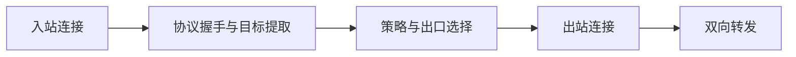

# 总体架构

状态：设计草案。本文表达建议的职责边界，不代表当前已有实现。

## 分层与职责

| 层 | 职责 |
| --- | --- |
| 应用装配 | 根据配置创建 client/server 组件，管理启动与停止 |
| 配置 | 读取 KDL 2.0，转换为类型化配置并校验引用与取值 |
| 会话与转发 | 管理会话、双向数据转发、超时、取消和资源回收 |
| 协议家族 | 共享编解码，分别实现入站/出站握手与角色适配 |
| 路由 | 使用规范化请求选择具备所需能力的出口 |
| DNS | 解析视图、上游选择、TTL/负缓存与可选乐观刷新 |
| 缓存与状态 | 有界缓存、持久提交、版本与恢复，不在持久层决定协议有效期 |
| 抽象接口 | 通过 ngcpp/proxy 表达组件所需能力 |
| 运行时与传输 | 基于 Corosio 集成协程执行、连接建立和异步 I/O |
| 平台与宿主 | 提供 socket、包设备、网络观测和宿主配置等窄能力 |
| TUN 与 TCP/IP | 自研包处理、传输状态机与平台设备适配 |
| TLS 与指纹 | 自研 TLS 协议处理与 ClientHello profile，密码原语使用 BoringSSL libcrypto，不使用第三方 libssl |

配置层输出可用于装配的配置数据，不直接创建监听器或连接。协议解析与底层传输应保持独立，便于复用同一协议的不同传输实现。

协议家族、入站接入、出站连接器及公共转发分别组织，具体组合声明能力与前提，见[协议设计](protocols.md)。[平台层](../platform/abstraction.md)隔离 OS/宿主 API，并通过契约注入，协议核心不直接操作平台后端。

## 概念数据路径

client 与 server 使用相同的处理阶段，具体入站、出口和策略由角色及配置决定。“入站”和“出站”是组件职责，“client”和“server”是部署角色，二者不应绑定为一套固定协议。

上图描述 L4 连接路径。TUN 等 L3 输入先进行路由预判，再选择包转发或进入自研 TCP/IP 栈形成流/数据报；出口能力决定可用路径，信息不足时推迟决定。详细路径见[TUN 设计](tun.md)。TLS 在需要加密的流路径中作为独立层接入，见[TLS 设计](tls.md)。

## 接口与生命周期

建议将入站处理、出站连接和流传输能力定义为独立 facade，具体签名在协程类型与所有权实验后确定。不要在此阶段冻结 C++ API。

会话需要拥有或明确借用连接、缓冲区和协议状态；异步操作完成前，其引用的资源必须保持有效。双向转发需要明确背压、半关闭、一侧失败后的另一侧处理，以及取消的传播关系。

建议采用“配置解析与校验 → 组件装配 → 运行 → 停止接入 → 结束会话 → 回收资源”的生命周期。启动失败回滚、停止超时和强制关闭行为需在实现前补充设计。

注册、上下文和分阶段生命周期见 [组件模型](component-model.md) 与 [核心架构原则](../design-principles/core-architecture.md)。

转发、公平性、批处理、加速路径、规则编译及资源预算见 [性能与资源设计](performance.md) 与 [性能与数据面原则](../design-principles/performance-and-datapath.md)。

[DNS 设计](dns.md)区分内部地址解析与消息交换，规定解析视图、回环防护、普通/负缓存和乐观刷新边界；[缓存与持久状态](state-and-cache.md)区分可丢弃缓存、用户选择、FakeIP 与宿主恢复记录，尚未选定存储依赖。

[HTTP 栈](http.md)明确 HTTP/1.1 自研、HTTPS 组合自研 TLS，以及未来可选 nghttp2 的职责。[规则集](../configuration/rule-sets.md)使用 KDL/BEVE 双向语义模型，加载与离线转换复用校验，匹配索引独立编译。
