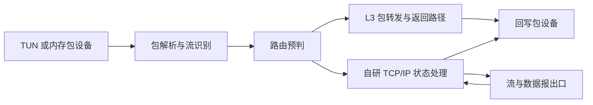

# 自研 TUN 与 TCP/IP 栈

状态：已实现独立的 IPv4/IPv6 UDP 报文基础和有界内存链路；完整用户态栈与 TUN 接入仍为设计草案。

## 当前实验

`nexus.packet` 提供不依赖系统网络的 IPv4/UDP 报文解析和构造，以及单执行上下文拥有的双向内存包链路。解析要求 IPv4 无选项、报文长度与输入精确一致，验证 IPv4 头部及非零 UDP 校验和，接受 IPv4 合法的零 UDP 校验和；拒绝分片、保留标志和非 UDP 协议。构造器设置 DF 和 TTL 64，计算两个校验和并遵守调用方 MTU；不做分片或重组。解析返回的 payload 借用输入，输入被修改或释放后不可使用。

IPv6/UDP 包层支持基础头直接承载 UDP，或依次携带至多一个逐跳选项头和一个目的地选项头；选项接受 Pad1、零值 PadN 和处理位要求跳过的未知选项，校验 UDP 长度和必需的非零校验和，伪首部长度不包含扩展头。要求丢弃的未知选项、路由头、分片及 jumbogram 不支持；尚未生成选项错误对应的 ICMP 报文，选项格式依据 [RFC 8200](https://www.rfc-editor.org/rfc/rfc8200.html)。构造器按 MTU 构造，payload 借用输入的生命周期规则与 IPv4 相同。固定样本及内存往返已通过；IPv6 报文的独立原始包对端尚未验证。

IPv4/TCP 报文层解析和构造固定 IPv4 头、TCP 序列号、确认号、标志、窗口、紧急指针、选项与载荷，验证 IP 和 TCP 伪首部校验和、TCP 头长度和 MTU；IPv4 选项、分片和 TCP 保留位拒绝。独立的 TCP 选项解析器校验选项区长度和每个变长选项的边界，保留 NOP 和未知类型，遇 EOL 停止；不检查各选项的语义，报文解析本身也不会自动调用它。返回的选项和载荷借用输入。GCC 16 固定字节样本、截断、校验和、长度和最大报文测试通过；尚无 TCP 连接状态机、IPv6 TCP 或独立原始报文对端验证。

独立 SYN 选项解码器进一步提取 MSS、窗口缩放、SACK 许可和时间戳，忽略未知选项，拒绝这些已知选项的错误长度和重复项。窗口缩放超过 14 时按 [RFC 7323 §2.3](https://www.rfc-editor.org/rfc/rfc7323.html#section-2.3) 取 14；重复项拒绝是当前实验策略。解码器不判断报文是否为 SYN、协商状态、MSS 可用性或时间戳回显的有效性，这些属于未来连接状态机。

`nexus.tcp.receive` 是单 owner 有界接收缓冲实验：用 32 位序号承载乱序数据，已占用字节优先，填洞后推进连续接收序号；读取释放空间并推进窗口，超窗字节丢弃。容量小于半个序号空间，调用方须保证每次输入为正常 TCP 报文大小；返回的窗口是从连续接收序号到缓冲右边界的距离，乱序占用仍在此区间内。GCC 16 测试覆盖重复、冲突重叠、填洞、序号回绕、满窗口和读取后恢复；尚未接入报文、ACK、连接状态或实际代理。

接收缓冲可记录窗口内的乱序 FIN：此前的数据补齐时 FIN 消耗一个序号，已连续数据仍可读取；FIN 后已缓存和新到的数据丢弃，重复 FIN 与不同位置的冲突 FIN 分别报告。FIN 位于窗口右边界或已确认数据之前时拒绝。此实验只跟踪接收方向，调用方仍需负责报文可接受性、ACK 和连接关闭状态。

`nexus.tcp.send` 提供单 owner 有界发送缓冲：保留排队数据至累计 ACK，区分未发送和已发送数据，提供拥有的首段重传副本；仅接受已发送范围内的 ACK，重复 ACK 不改变状态，序号按 32 位回绕。调用方必须在实际提交发送后标记已发送，并负责发送窗口、重传调度、拥塞控制和 FIN；当前没有连接状态机或网络 I/O。为保证分配失败时入队不部分生效，当前入队会复制已有队列，性能尚未评估。

实验性 `TimedSend` 在该缓冲上提供虚拟毫秒驱动的重传期限：首个在途数据启动 1 秒计时，成功重传后指数退避至最多 60 秒；新的累计 ACK 在仍有在途数据时重启当前计时，全部确认后停止并重置。重复 ACK 不重启计时；时间倒退拒绝。到期查询不会自行提交重传，调用方实际提交后须显式确认；当前没有 RTT 估计、快速重传、拥塞控制或 I/O 失败管理，不构成完整 TCP 重传实现。

GCC 16 内存组合测试将 IPv4/TCP 编解码、发送计时、接收重组和虚拟链路串接：首段丢失、后段先到、超时重传填洞，随后累计 ACK 报文丢失并再次重传，最终只交付一次完整数据。ACK 报文由夹具构造和解析，并非完整 TCP 对端；握手、窗口控制及独立栈互操作仍未验证。

`nexus.tcp.handshake` 提供单四元组的被动握手实验：接受无数据 SYN，检查选项，记录对端 MSS（缺省 IPv4 为 536）并生成无选项 SYN-ACK；重复 SYN 可触发调用方重发，匹配的 ACK 可携带数据、PSH、FIN 和结构有效的选项。握手完成后调用方必须继续处理同一报文的数据和 FIN；测试将其交给接收缓冲，窗口装满时 FIN 须等待重传。独立虚拟时间计时器在首发后从 1 秒开始指数退避，最多确认四次重传，之后报告超时；调用方负责提交重传、握手完成时停止及回收资源。初始序号由调用方提供，GCC 16 测试覆盖报文编解码、序号回绕、错误 ACK、错误对端、重传与超时。该子集尚未实现 RST、连接资源限制、选项协商、随机初始序号或生产连接集成，不可作为通用 TCP 监听器。

`nexus.tcp.connection` 将被动握手、计时、收发缓冲组成单流实验：握手完成时保留最终 ACK 的数据，接收同一四元组数据并生成累计 ACK 和窗口；接收 FIN 可乱序等待数据，连续后进入对端关闭状态，排空数据后报告 EOF。发送数据按对端窗口及 MSS 限制，调用方提交发送和到期重传，累计 ACK 回收数据。GCC 16 测试覆盖收发、窗口、重传、FIN、错误对端及握手超时。调用方负责发送首个 SYN-ACK、驱动时间和处理 I/O；握手输入检查单调时间及期限，到期后拒绝迟到报文，握手完成时间也传递给发送计时。此实验尚无窗口缩放、完整报文可接受性、拥塞控制或真实网络接入，不能作为生产 TCP 实现。

过期累计 ACK 不回收发送数据，也不覆盖较新的对端窗口，但同一报文中可接受的数据仍会进入接收缓冲。接受的窗口更新按报文序号和累计 ACK 排序：序号较新，或序号相同且 ACK 不早于上次更新时才更新；比较按 32 位环绕处理。测试覆盖乱序窗口通告和序号回绕，独立协议栈互操作仍待验证。

对端缩小窗口时，普通重传只返回从最早未确认序号起、落在当前窗口内的数据；窗口为零时改用零窗口探测。窗口恢复后仍未确认的数据继续按重传期限发送。

本地关闭请求禁止继续入队，等待所有排队数据确认且对端窗口非零后才允许发送 FIN；FIN 消耗一个序号，有独立的指数退避重传期限，确认后报告发送方向关闭。主动关闭在双方 FIN 完成后保留四元组 120 秒，期限内重复 FIN 重启期限；被动关闭无需该期限，两种路径都须排空已接收数据才报告可回收。期限到达后输入不再重启期限，可回收一旦报告成功也不再接受输入；未读数据仍可排空。调用方负责发送、确认提交、按单调时间驱动回收及实际保留四元组。当前没有完整 FIN-WAIT/LAST-ACK 状态或生产连接管理，不能据此宣称完整关闭实现。

对端窗口为零且有排队数据或待发送 FIN 时，调用方须周期性调用 `probe_due`：首次调用启动 1 秒期限，到期返回首个在途字节或首个未发送字节；仅在实际发送后调用 `probe_sent` 提交，并按 2、4 秒递增至 60 秒。新字节提交后占用序号、可被累计 ACK 确认；重复探测重发同一在途字节。仅等待 FIN 时返回序号为发送下一序号减一的空 ACK 探测。窗口重新开放时停止探测并恢复普通发送；零窗口期间普通数据重传由探测代替。调用方构造并发送带返回序号和数据的 ACK 报文，也须对不可接受的入站探测发送当前 ACK。此机制尚未与独立 TCP 栈互操作验证。

虚拟链路测试将单流发送端、报文编解码和接收缓冲组合：接收窗口填满后丢弃重新开放的通告，再丢弃首次探测的 ACK；重复探测只交付一次数据，后续数据在窗口恢复后继续发送。对端 ACK 由测试夹具生成，不代表独立 TCP 栈。

建立后先检查接收序号与窗口再处理 ACK；零窗口时仅接受下一序号的空报文，关闭后的重复 FIN 可触发 ACK 并确认本地 FIN，即使重传报文还包含 FIN 前的数据。重复数据不会再次交付；主动关闭的 TIME-WAIT 内这类 FIN 也会重启期限。GCC 16 测试覆盖超窗 ACK 不回收发送数据、零窗口 ACK 边界及重复数据和 FIN 携带确认。

连接的握手、输入、发送、探测、FIN 和回收计时接口共享单调时间；查询 FIN 期限也会推进该时间。时间倒退不会复位连接、确认 FIN 或提交重传。调用方须对所有计时接口使用同一单调时钟，不应先查询未来时间再提交更早的事件。

`nexus.tcp.table` 是单 owner 的有界 IPv4 单流表：按入站四元组查找，限制连接数和每流缓冲容量，拒绝重复四元组；表内 ID 单调分配、不复用，耗尽时拒绝新建。正常关闭的回收除单流关闭和 TIME-WAIT 条件外，还须确认应用已观察到 EOF；引擎读取返回 EOF 时自动确认，直接使用单流的调用方须在报告 EOF 后调用 `observe_eof`。握手超时或复位可直接回收；显式 `abort` 强制丢弃连接及缓冲。`get` 返回的借用指针在该连接移除、表销毁或被移动赋值时失效；调用方负责按 ID 驱动每个连接的计时及发送。GCC 16 测试覆盖容量、重复四元组、TIME-WAIT 和未观察 EOF 的保留、握手超时、复位、强制删除和旧 ID；线性查找尚无性能验证。

`nexus.tcp.dispatch` 将 IPv4/TCP 解析与连接表衔接：新 SYN 创建流并返回 SYN-ACK，既有流接收报文，数据、FIN、不可接受报文及挑战 ACK 场景返回拥有的 ACK 字节；纯 ACK 不触发 ACK，超窗 RST 静默丢弃。错误与连接 ID 同步报告；未知非 SYN 不创建连接。调用方提供初始序号、单调时间及 MTU，负责安全产生初始序号、发送或在背压时保留返回的报文，并驱动计时、数据发送与回收；此函数无输出队列，输入状态在返回前已经改变。SYN-ACK 丢失的重传仍由调用方处理。GCC 16 测试覆盖校验和、MTU、容量、重复 SYN、数据和重复数据 ACK、挑战及复位；尚未接设备、路由、出口或独立 TCP 对端，也未实现未知流 RST。

内存引擎可持有不可变的规则匹配快照：新 IPv4 SYN 在建流前按目的 IP 检查，命中规则或匹配错误即拒绝，不创建连接或发送 SYN-ACK；默认空规则放行。既有流沿用建流时的判定。直接调用无策略的 `dispatch`、直接向表插入连接或替换表可绕过此检查，使用者须通过该引擎的策略入口建立受保护的流。GCC 16 测试覆盖阻断不占容量、畸形报文、未命中及表满时的阻断；当前仅有 IP 阻断和默认放行，没有完整路由、动态策略或真实出口。

`nexus.tcp.engine` 将上述分派连接到 `MemoryLink` 的第二端，每步最多消费一个输入，最多保留一个待交付应答。输出队列满时保留应答并停止消费输入；连接被中止、回收、复位或过期后丢弃其待发应答并报告，避免旧 ID 的应答流入新连接。设备永久无法容纳报文时丢弃并报告，设备关闭等输出错误也报告。调用方可以将字节排入连接发送缓冲，再以 `transmit` 按对端窗口、MSS 和 MTU 输出一个数据段；设备队列满时保留未发送数据，只有成功入队后才推进序号并启动重传计时。调用方拥有连接表和设备，在引擎存活时不得移动或替换连接表，负责安全生成每次可能建流的初始序号，并串行处理计时、发送和回收。此基础引擎本身不包含外部数据出口或生产事件循环；隔离 TUN 集成验证见下文。背压期间不推进其他流的期限。GCC 16 测试覆盖应答排队、恢复、输入暂停、数据输出背压、MTU 分段、时间倒退、错误输入、关闭及中止后旧应答丢弃。

调用方还可按时间驱动 `retransmit`、`probe` 和 `send_fin`：数据重传受窗口、MSS 和 MTU 限制，零窗口探测及 FIN 包含空载荷时通过 `delivered` 区分已发与无事可做；只有成功入设备后才提交对应序号或退避，队列满时可重试。GCC 16 测试覆盖数据重传、零窗口数据和空 ACK 探测、FIN 首发与重传，以及它们的设备背压。

`service(now)` 按连接 ID 轮转，每次最多处理一个流、输出一个包：推进握手重传或超时，回收符合条件的流，并依次尝试数据重传、零窗口探测、FIN 和新数据。输出满不会提交发送；有待交付入站应答时须先调用 `step` 排空，该期间 `service` 不推进流计时。该入口对已建立连接要求 MTU 大于 40 字节，调用方须持续交替驱动输入和服务，提供单调时间并消费设备输出；它不是后台事件循环。GCC 16 测试覆盖两流轮转、握手重传背压、数据重传、探测、FIN、TIME-WAIT 和握手超时回收；线性查找的性能及独立栈互操作尚未验证。

应用可经引擎 `read` 排空接收缓冲：读取使通告窗口增大时立即生成 ACK；设备满则保留该 ACK，并暂停后续读取和服务，直到 `step` 排空。返回值同时报告已读字节、EOF 和应答状态，已读字节即使应答受阻也已交付。若直接调用连接的 `read`，调用方仍须自行发送窗口更新。GCC 16 测试覆盖零窗口恢复、窗口通告背压、输入/服务暂停及 FIN 后 EOF；尚未接生产流接口。

Linux `nexus.tcp.direct` 提供实验性 IPv4 直连：对已建立的内存流再次按目的 IP 检查规则后创建非阻塞 socket；单 owner 每次轮转一个流，最多持有每流 16 KiB 的待发送字节，并按 TCP 发送缓冲空余容量读取上游。客户端 EOF 排空后对上游半关闭，上游 EOF 请求向客户端发送 FIN。socket 故障会关闭并报告，出口驱动引擎向客户端发送 RST；若已有应答待发则保留失败流并重试，RST 已排入引擎后出口即可回收，连接表保留该流直到 RST 交付或无法交付。`start` 的立即 socket 故障同步返回错误，并保留待复位流供后续 `step` 处理；策略拒绝和容量等启动错误由调用方处理。流被回收或复位后下一次轮询关闭 socket，显式 `close` 和析构也关闭 socket。调用方以单调毫秒启动并轮询出口；连接尚未完成时，从启动起 10 秒到期后在该流下次轮询时报告超时、关闭 socket 并发送 RST。期限前未轮询无法及时检测成功，因此到期时即使 socket 已就绪也按超时处理。调用方还须交替驱动引擎和出口、处理输出背压、取消及错误；当前先完成内存端握手再拨号，未实现生产所有权管理。GCC 16/Linux 本地回环测试验证阻断、双向数据、发送缓冲满后暂停与恢复、双向半关闭、拒绝连接后的 RST 和已有待发应答时的重试；受控 poll 替身验证了超时边界、时间倒退、socket 关闭和 RST；这不验证 TCP 原始包与独立栈互操作，也未接真实 TUN。

上游接收使用每流额外 16 KiB 暂存，只有成功放入 TCP 发送缓冲后才释放暂存；入队分配抛异常时调用方可再次轮询，避免已从 socket 读取的数据丢失。两方向的固定暂存合计每流 32 KiB，另有 TCP 缓冲、socket 和对象开销，流数上限由调用方设置。真实回环测试在接收后注入一次 `bad_alloc`，验证重试只入队一次；这不涵盖其他异常或资源耗尽场景。

内存组合层在新流所有权登记或直连启动抛异常时中止相关流并传播异常；直连启动时已打开的 socket 也会关闭，不保证发送 RST。回环故障测试覆盖 socket 创建后的单次分配失败及之后的新流创建，尚未覆盖引擎内所有异常路径。

新流 SYN-ACK 构造抛异常时中止该流；入包保留供后续重试。应答排队发生 `bad_alloc` 时保留应答并返回流 ID 和背压，供组合层管理。已有流先预留应答存储再修改状态，入包分发抛异常时保留入包及原始 ISS 供重试；当前每个已有流入包都会分配一个 40 字节应答缓冲，性能尚未评估。故障注入覆盖新流和携带数据的握手最终 ACK，不能据此推断任意异常或所有状态更新均安全。

引擎读取客户端数据前预构造窗口更新，构造分配失败时数据仍保留在接收缓冲；更新排队时发生 `bad_alloc` 则返回已读取的数据并保留更新，报告背压供调用方驱动重试。专项注入覆盖上述两次分配，未覆盖所有异常类型。

内存引擎的待发包排队遇到 `bad_alloc` 时统一报告背压并保留包；RST 在构造成功后保持连接表条目，直至报文投递或无法投递。故障注入验证 RST 连续多次排队失败后仅投递一次并释放条目；这不覆盖生产设备或所有异常类型。

内存报文交换器在任一方向的队列分配失败时保留该报文并报告背压，另一方向仍可推进；双向连续故障和恢复后单次交付已测试。UDP 引擎以 128 个固定槽汇集两族各最多 64 个回包，汇集无需扩容，另一族轮询抛异常时已汇集的回包保留。UDP direct 预留批次并先窥看再构包，构包分配失败时数据报留在内核供重试；两族回环故障注入通过。该方式要求 socket 无其他读取者，增加一次接收系统调用，队列溢出仍可丢包，性能尚未测量。

UDP 引擎投递回包时的内存队列分配失败报告背压并保留回包，同一步的入包拒绝仍可观察；回环故障测试覆盖连续失败和恢复后单次交付。

UDP 引擎入包提交发生 `bad_alloc` 时保留原始入包、在步骤中标记 `input_allocation_failed`，并继续处理回包；下一步重试同一入包。IPv4 和 IPv6 回环均覆盖逐位置故障，验证没有重复发送。

引擎分别报告 IPv4 和 IPv6 出口轮询的 `bad_alloc`，并继续处理另一族和返回同一步其他结果；已有批次后发生分配失败时 direct 先返回批次，下一次轮询报告该故障，然后可继续重试。引擎会先排空待发回包再报告延迟故障；其他异常仍传播。

两族回环故障注入覆盖第二流窥看后的消费调用：EAGAIN 和 EINTR 留待下次重试；EIO 关闭该流并在已收集回包交付后报告。测试模拟调用直接返回错误，不证明内核部分完成的行为。

UDP 内存引擎保留入包直至 direct 提交返回；当前发送前完成所需分配，发送后提交不分配。IPv4 和 IPv6 回环逐位置注入普通分配失败，验证重试未重复发送；其他异常尚未验证。

发送系统调用返回错误时，UDP direct 关闭流，内存引擎报告失败且不自动重发。两族回环通过包装调用模拟发送前 EIO 和成功发送后伪造 EIO，分别确认对端无包或恰收一包；这不推断真实内核错误的完成语义。

直连出口将 EOF 确认延后至本地缓冲全部交给 socket 且 `shutdown(SHUT_WR)` 成功，避免连接表在出口仍持有数据时回收。另有 GCC 16 本地回环端到端测试从内存设备注入 SYN、ACK、数据和 FIN，经分派、连接表及直连 socket 与真实服务器交换数据，再处理返回数据、FIN 和回收。入站报文由测试夹具构造，真实服务器只验证出口 TCP 流，不能代表原始 TCP 报文与独立栈互操作。

握手及建立后的 RST 按 [RFC 9293](https://www.rfc-editor.org/rfc/rfc9293.html#section-3.10.7.4) 检查四元组和序号：精确匹配下一接收序号则进入复位状态，窗口内其他序号返回挑战 ACK 请求，窗口外拒绝。调用方负责发送挑战 ACK 和销毁复位对象以回收缓冲；监听器及其恢复 LISTEN 的行为尚未实现。

内存链路每个方向分别限制包大小、包数和字节数，发送时复制并保留队列所有权；满队列立即返回错误。接收取走所拥有的包，空但仍开放时返回空，发送端关闭后允许接收端排空队列再返回对端关闭；接收端关闭丢弃其待收队列。此同步实验对象不提供多线程同步、阻塞等待或虚拟时钟。

`nexus.udp` 另提供单 owner 的 IPv4 和 IPv6 UDP 流表实验：映射独立支持 endpoint-independent、按远端地址、按远端地址和端口三种方式，回包过滤也独立选择这三种方式。创建映射本身不授权回包；发送入口先预留目标容量，完成成功后才授权，失败或取消释放预留；每个流最多一个在途发送，关闭或过期后的迟到完成无效。同步回调接口基于同一状态机，回调不得重入，允许的回包及成功发送刷新空闲期限，未经授权的回包不会刷新期限。每流目标上限和总流数上限在满时拒绝新增，不隐式淘汰；显式关闭和到期回收后标识不会复用。时间由调用方传入单调毫秒，倒退报错；同一时刻调用顺序决定到期与事件处理。当前线性查找适用于实验，性能、真实 socket 所有权、异步 I/O 和生产集成策略尚未验证；调用方须在完成回调前维持发送缓冲及执行器所有权。完成前到达的回包不获得新目标授权，可能被丢弃；在途操作不延长流空闲期限，过期后即使系统实际发出数据也不会恢复映射。

流表及两种桥接可选接收同步 `RetirementHandler`，显式关闭或任意操作触发的隐式到期都会在移除流时通知一次，让单 owner 释放关联出口资源。回调不得重入流表、不得抛异常，回调上下文必须活得比流表久；首次准备回滚也可能通知尚未返回的 ID，接收方须允许不存在的资源。`clear(now)` 一次通知并移除全部流，返回包括本次过期流在内的数量，旧发送令牌失效；时间倒退时不改变状态。析构不通知，所有者须在停止时调用 `clear` 并等待在途操作结束，再释放回调上下文和 socket。GCC 16 测试覆盖隐式到期、显式关闭、迟到完成、预留回滚及 IPv6 桥接；Linux 回环夹具验证到期通知关闭真实 socket；异步夹具验证 `clear` 关闭 socket 后挂起接收以取消完成、事件循环排空及迟到令牌失效。这只是资源回收接口，尚无生产出口管理器。

`Bridge4` 和 `Bridge6` 分别将 IPv4 和 IPv6 包解析、流映射和发送令牌串接：准备出口时复制 payload，调用方负责执行发送并报告完成；回包先按流与来源过滤，再按指定 MTU 构造对应的 UDP/IP 包。无效包不会建立流，发送失败不会授权目标，超 MTU 回包不会刷新流期限。每流只有一个在途发送；首次准备若未能预留发送容量则回滚新流，已提交发送失败的新流仍占用容量直到关闭或到期，调用方必须处理完成、关闭及超时。此核心不做路由、策略、socket 管理或调度，不可直接视为生产代理。

Linux `nexus.packet.fd` 的 `FdPump` 借用调用方提供的非阻塞、保留报文边界的文件描述符，将其与 `MemoryLink` 第一端双向连接；每次最多读取和写入各一个报文，每方向最多持有一个待发包。队列满或 `EAGAIN` 时保留并重试，超过 MTU 的输入或输出报告并丢弃，部分写入报告错误且不重发；描述符、链路和可能的 SIGPIPE 由调用方管理。GCC 16 测试使用 Unix 报文 socket 验证非阻塞检查、双向背压恢复和超长包拒绝；组合夹具通过该泵和共享内存引擎完成真实 IPv4 TCP/UDP 回环双向传输。读取后的报文保留在预分配缓冲中；内存队列分配失败时报告背压并可重试，故障注入验证恢复后仅交付一次。隔离 TUN 上的基本读写已在下述 Linux TCP 互操作测试中验证；包元数据、生产事件循环和取消仍待验证。

`nexus.packet.mux` 的 `MemorySwitch` 使用三个内存链路，将外部 IPv4 TCP、IPv4 UDP 和IPv6 UDP 及其逐跳/目的地选项候选分派至两个内部链路，并轮流收取内部回复。它仅检查版本和协议字段，完整报文校验由相应引擎执行；其他协议和短头报告不支持，选项头的完整合法性由 IPv6 UDP 解析器检查。每方向最多持有一个待转发包，目标队列满时保留并暂停该方向的下一次读取，两个方向仍可各自推进；输入顺序保留，因而某协议的内部队列满可能阻塞后续其他协议的输入。过大报文报告并丢弃，关闭等错误报告给调用方。GCC 16 内存测试覆盖三类分流、拒绝、双向背压、轮转及设备关闭；尚未接真实设备。

Linux `nexus.tcp.stack` 的 `MemoryDirect4` 将内存引擎和直连出口组成单 owner 驱动层：每次最多处理一个输入、一个出口和一个表服务项，在收到握手完成报文后启动直连；启动资源不足等错误会报告并向该流发送 RST，输出受阻时保留待发复位。调用方提供安全初始序号和单调毫秒，持续调用 `step` 并处理每一部分的错误和背压；表和内存设备必须比驱动层存活更久。它只管理经自身输入完成握手的流，不接真实 TUN，也没有后台调度或 UDP 复用。GCC 16 回环测试覆盖自动拨号、双向数据、容量不足、输出队列满时的复位、双向半关闭后回收与出口名额重用、客户端 RST 后 socket 关闭及时间倒退；另有八条并发回环流的双向数据隔离和逐流 RST 回收测试。尚未证明独立 TCP 栈互操作或生产负载行为。

Linux `nexus.transport.memory` 将内存分流器、TCP 组合层和 UDP 引擎连接到同一外部 `MemoryLink`；每步依次推进分流器、TCP、UDP，内部使用独立有界链路。调用方提供单调毫秒与安全 TCP 初始序号，处理各子步骤报告和错误，并持续调用；时间倒退在分流前拒绝。后续子步骤出错时，之前子步骤可能已产生效果，调用方应将错误视为终止条件。设备和 TCP 表必须比组合层存活更久；终止式 `stop` 关闭 TCP/UDP 出口、丢弃内部待发包并回收本实例创建的 TCP 流，重复停止安全，停止后拒绝驱动；外部设备中已排队的包仍由调用方管理。析构也关闭出口并回收本实例创建的 TCP 流。GCC 16/Linux 测试经同一内存设备交错完成真实 IPv4 TCP、IPv4/IPv6 UDP 回环双向数据传输及时间倒退检查；外部输出队列满时验证保留 IPv6 回复、继续处理 TCP ACK、虚拟时间跨越 UDP 空闲期限后流到期及排空后交付；随后 TCP 双向关闭并回收连接表项。未进行长时间实测或生产调度验证，也未接真实 TUN。

Linux `nexus.udp.direct` 提供实验性 `Direct4` 和 `Direct6`：每流一个对应地址族的非阻塞 UDP socket，提交时先执行对应的路由桥接策略与发送预留，完整发送后授权回包；socket 错误关闭该流，`EAGAIN` 作为发送失败返回而不排队。调用方定期以单调毫秒调用 `poll`，每次最多轮询 64 个流、每流收一个包，轮转起始位置；合法回包按 MTU 重建为拥有的 IP 包，非法来源和超限回包丢弃。流到期、`stop` 或析构关闭相应 socket，`stop` 不禁止再次提交。GCC 16/Linux 回环测试覆盖规则阻断、畸形包、真实发送/回包、伪造来源、超 MTU 不刷新期限、过期及停止。它不依赖 TUN、没有后台线程或阻塞等待；`Direct6` 打开双栈 socket 以支持 IPv4 映射 IPv6 地址，并按 IPv6 和 IPv4 规则检查；IPv6 zone 不支持。IPv6 及映射 IPv4 的实际回环往返、策略阻断、来源过滤和到期也经 GCC 16 测试。目前没有接入配置、代理入口或正式事件循环，尚未进行吞吐及负载验证。

IPv4 和 IPv6 各以 65 个静态流进行回环测试，验证 64/1 分批、连续两批回复的轮转无重复，并在 64 个流到期后创建替换流；持续高负载吞吐和动态增删竞态尚未验证。

Linux `MemoryEngine` 将有界 `MemoryLink` 的第二端与 `Direct4` / `Direct6` 串接，按 IP 版本分发，每步最多处理一个入包；规则阻断和发送失败通过步骤结果报告。每个出口每次最多收 64 个回复，引擎最多持有 128 个待交付包；设备队列暂时满时保留回复并暂停读取新包，直到队列可用；若单包超过设备总字节预算或单包限制，则丢弃该包并返回 `packet_too_large`，后续包可以继续。设备关闭返回错误，调用方须停止引擎；停止关闭所有出口并丢弃待交付包。调用方保持设备寿命并驱动单调时间；持续背压期间每步仍执行流过期和 socket 回收，但不读取出口，内核缓冲区可能丢包；此前已接受并排队的回复即使流随后过期也仍按顺序交付。GCC 16/Linux 端到端测试覆盖内存设备、IPv4/IPv6 真实回环、阻断、设备队列满后恢复、时间倒退及设备关闭。这是内存设备集成，未接真实 TUN 或配置。

步骤结果分别报告入包拒绝、IPv4 和 IPv6 接收错误及设备输出错误，保留同一步已完成的其他结果。设备输入失败或时间倒退则作为步骤错误返回；调用方应同时检查步骤结果中的各项错误和进度。

`RoutedBridge4` 和 `RoutedBridge6` 为各自的核心附加不可变规则快照：每次提交包时先验证包，再按目标 IP 查询现有规则匹配器；命中即阻断，未命中走 direct，匹配失败也拒绝，均在创建流和发送前完成。IPv4 映射 IPv6 地址同时检查 IPv6 与 IPv4 规则。此实验只有 IP block/default direct，不含域名解析、完整多出口选择或动态重载；回包过滤仍按所配置的 UDP 过滤策略独立执行。

GCC 16/Linux 测试使用独立计算的固定 IPv4/UDP 字节样本，覆盖奇数长度、校验和为零的编码、截断、伪首部与负载篡改、分片、长度、MTU、队列限额、所有权、关闭及内存中的 UDP 请求/回包。映射与过滤的九种组合、目标与流限额、拒绝回包、过期/关闭、旧标识及虚拟时间和内存报文往返也经 GCC 16 测试。另用 Linux 回环 UDP socket 通过 `Bridge4` 测试内存包、真实发送/回包、伪造源过滤、发送失败和过期；Corosio 默认 epoll 夹具已连接 `Bridge4`，使用桥接结果持有的 payload 异步发送，经系统 UDP 回环对端回包并重建 IP 包，同时覆盖提交前取消与挂起接收的取消和关闭；发送完成令牌与桥接关联。另在事件循环运行前安排发送并关闭或过期流、创建替代流，再运行循环：真实数据报到达但旧完成返回 stale，不能授权新流，发送协程自持 payload。此顺序不证明发送已提交内核后可以取消。socket 只存在于测试夹具，提交前取消发送返回取消且未观察到数据报；已经提交的发送取消与生产生命周期仍待验证。IPv6 桥接的内存测试覆盖未完成发送、来源过滤、MTU、到期和回包重建；Linux IPv6 回环 UDP 对端测试覆盖真实发送和回包、伪造来源拒绝、内存包重建及到期。该对端收发 UDP payload，不能单独验证 IPv6 包层与内核的原始报文互操作。它没有接入系统 TUN、生产 UDP 出口、完整路由、系统 NAT、ICMP 或 TCP，亦不代表 UDP 代理已实现。

## 目标与职责

参考近期 sing-box/sing-tun 的自有栈方向，由 Nexus 自行实现 TUN 接入与代理所需 TCP/IP 处理。参考来源和版本见[调研记录](../references/sing-box.md)。

应区分操作系统的 TUN 设备与用户态 TCP/IP 栈：设备提供 L3 包读写，协议栈负责把包转换为 TCP 流、UDP 数据报等能力。自研栈仍需适配操作系统接口；各平台的设备或驱动接入方式另行验证。

## 层次划分

| 层 | 建议职责 |
| --- | --- |
| 设备适配 | 打开与关闭设备、MTU、包读写、队列和平台特性 |
| 平台网络管理 | 接口地址、路由、DNS、出口绕行及失败回滚 |
| 包基础设施 | 包视图、长度校验、校验和、缓冲区所有权 |
| IP 与控制报文 | IPv4/IPv6、分片策略、ICMP 错误和 MTU 反馈 |
| 传输协议 | TCP 状态机、UDP 流处理与超时 |
| 流与策略集成 | 预判、L3/L4 分派、NAT、返回路径与统计 |

包设备接口建议支持内存实现。先在不操作系统网络配置的环境下验证包序列与状态，再验证真实 TUN 接入。

隔离网络命名空间的 `tests/tcp_kernel_tun.py` 在临时 TUN 上连接 Linux 内核 TCP 客户端与 `MemoryEngine`：真实 SYN/ACK、双向数据及客户端先半关闭后服务端关闭连续十轮通过（Linux 7.3.0-4-cachyos，GCC 16）。另丢弃首个 SYN-ACK、首个客户端数据段和首个服务端数据段，观察双方重传后数据各交付一次、正常关闭，连续五轮通过。测试用 `FdPump` 驱动 TUN，过滤 IPv6 后将 IPv4 报文交给 TCP 引擎；应用侧是内存应答，不包含直连出口。先运行 `xmake build nexus-tcp-kernel-tun-test`，再运行 `python3 tests/tcp_kernel_tun.py build/linux/x86_64/debug/nexus-tcp-kernel-tun-test`；执行需要用户命名空间、网络命名空间、`ip` 和可用的 `/dev/net/tun`，网络配置随命名空间消失。此结果不证明系统接管、代理回环防护、其他丢包与乱序交错、性能或其他平台的互操作。

进一步的 `tests/transport_kernel_tun.py` 由 `LinuxTun` 在隔离命名空间独占创建 TUN，将描述符副本传递给宿主侧测试进程，Linux TCP 客户端经 `FdPump`、内存传输和 IPv4 直连访问宿主回环测试上游；客户端先半关闭，上游收到完整请求后回复并半关闭，双向数据与停止回收连续十轮通过。TCP 活动期间还通过同一 TUN 完成 IPv4 UDP 直连往返：另一源端口先注入回包，客户端仅收到预期上游的回复，连续五轮通过。夹具只在临时命名空间配置 TUN、回环目标路由和 `route_localnet`，宿主只创建回环监听 socket。先运行 `xmake build nexus-packet-tun-helper` 和 `xmake build nexus-transport-kernel-tun-test`，再执行 `python3 tests/transport_kernel_tun.py build/linux/x86_64/debug/nexus-transport-kernel-tun-test`。该实验不执行宿主系统接管，也不证明防环回、生产调度或其他平台支持。

`tests/transport_kernel_tun6.py` 在两个嵌套临时网络命名空间分别运行 Linux IPv6 UDP 客户端和 Nexus 直连出口，通过真实 TUN 访问外层命名空间的 IPv6 回环上游；不同源端口先发送的回包未被客户端收到，预期回包完整，连续十轮通过。运行已构建的 `nexus-transport-kernel-tun-test`：`python3 tests/transport_kernel_tun6.py build/linux/x86_64/debug/nexus-transport-kernel-tun-test`。Linux 客户端还发送带目的地选项、两个填充选项头组合及可跳过未知选项的报文，真实往返连续五轮通过。测试需要支持嵌套网络命名空间和 IPv6；其他选项行为、分片、zone 和系统接管仍未覆盖。

Linux 模块 `nexus.packet.tun_linux` 提供 `LinuxTun` 独占所有者：在调用方当前网络命名空间通过 `IFF_TUN | IFF_NO_PI | IFF_TUN_EXCL` 创建非持久 TUN，描述符设为非阻塞和 close-on-exec；名称可以由内核生成，也可指定不含模板的名称。名称无效、打开或 ioctl 失败返回错误，移动转移所有权，关闭或析构释放描述符；使用借用描述符的 I/O 必须在关闭前结束。接口不配置地址、MTU、路由、DNS 或防火墙，也不接入正式运行配置。`xmake build nexus-packet-tun-linux-test` 后执行 `python3 tests/packet_tun_linux.py build/linux/x86_64/debug/nexus-packet-tun-linux-test`，隔离命名空间测试已覆盖独占名称、描述符属性、移动及设备回收；其创建的设备也经上述 IPv4 TCP/UDP 真实传输测试；权限不足和其他平台行为未穷尽。

## TCP 与 UDP 的范围

自研 TCP 需要明确序号空间、握手、重传、乱序重组、ACK、窗口、流量控制、拥塞控制、FIN/RST、半关闭和定时器。对本地应用终止 TCP 的代理路径与原样转发 IP 包的 L3 路径分别实现和验证，不能将两者混为一种“转发”。

UDP 的映射行为与回包过滤行为分别建模：映射决定哪些流共享出口状态，过滤决定哪些远端回包可以进入。它们不应由单个“独立 NAT”布尔开关表达。会话数量、空闲超时、淘汰策略和跨队列一致性需要显式定义。

首轮建议从受控的 IPv4 包、UDP 和最小 TCP 流开始建立实验。该实验不代表完整栈可用；进入通用平台支持范围前，还需完成声明支持的 IPv6、ICMP、MTU、分片和异常包行为。首批支持清单尚未冻结。

## 调度与性能设计

借鉴 sing-tun 的引擎与平台队列分离、批量收发、控制消息、时间轮和内存设备，针对 C++ 与 Corosio 重新设计：

- 同一条流的可变状态尽量由同一执行上下文处理，跨线程操作通过明确的消息或调度边界传递。
- 先建立单队列正确性和基准，再验证流分片、多队列及跨队列返回路径。
- 定时器先满足正确性，数量成为瓶颈后再评估时间轮，记录精度与唤醒成本。
- 缓冲池、队列、乱序缓存、分片重组及 NAT 表都要有预算，定义超限行为。
- GSO/GRO、批量系统调用、零拷贝路径等优化需按平台能力验证，不提前宣称生效。

Corosio 用于异步 I/O 和协程协调，自研 TCP/IP 状态机保持独立。TUN 描述符、批量读写和包元数据能否通过其现有接口表达，需要实验确认；如需原生平台适配，限制在设备层并接入统一取消和执行器规则。

## 系统集成

平台网络管理需要保护代理自身的出口，避免流量重新进入 TUN；DNS 请求路径和代理服务器域名解析也必须有明确的绕行策略。配置路由和 DNS 时记录原状态及实际修改，部分启动失败后仅回收本实例创建的资源。

网络切换、设备关闭和 MTU 更新都应有独立事件处理。设备被关闭后应唤醒挂起读写，等待在途操作退出后释放包内存。

验证计划见[网络栈验证](../planning/network-validation.md)。内存实验没有创建 TUN 或修改系统路由。

进一步参考 sing-tun 的批处理与空闲回收、shoes 的包视图及紧凑复制设计，见[性能与资源设计](performance.md)。shoes 的 IP 栈使用 smoltcp；其设备、存储和唤醒组织可借鉴，不改变 Nexus 自研协议栈的方向。

Linux 的策略路由、nftables/NFQUEUE、mark、容器防火墙和 resolved 集成由[Linux 适配设计](../platform/linux/networking.md)细化，通用栈不直接持有这些系统对象。

Direct 出口轮询在已收集回包后遇到另一个 socket 错误时先返回已收集的包，并在下次 poll 报告该错误；stop 清除待报告错误。GCC 16/Linux 回环测试通过链接器包装 `recvfrom`，分别对 IPv4 和 IPv6 注入 EIO，验证先交付已收到的包、下一次报告错误、随后恢复，以及 stop 清除待报告错误。
