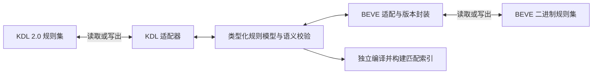

# KDL 与 BEVE 规则集互转

状态：谓词规则集统一使用 `schema-version 2`（v1 已移除），支持 KDL/BEVE 互转和顺序匹配；主配置可加载规则集并为其指定出口，Linux 提供独立转换命令。格式依据见[规则集格式](../architecture/rule-set-format.md)与[决策 0006](../decisions/0006-rule-set-formats.md)。

## 当前支持的规则

文件需包含一次 `schema-version 2`、一次 `kind "predicate"`，以及零个或多个有序的 `rule` 节点：

```kdl
schema-version 2
kind "predicate"
rule type="domain-suffix" value="example.com"
rule type="ip-cidr" value="192.0.2.0/24"
```

每条叶子规则有 `type`、`value` 属性；未知节点、属性、类型、版本和缺失字段均失败。当前采用 Glaze DOM 的 KDL 语义：同一节点的重复属性以最后一个值为准；这是 KDL 属性处理方式，不适用于 BEVE 对象重复字段，后者会被拒绝。类型和属性应直接写清楚，不依赖重复项。

v2 规则集支持 `domain-suffix`、`ip-cidr` 以及精确 `domain`、`domain-keyword`、`domain-wildcard`、`inbound`、`auth-user`、`ip-version`、`ip-is-private`、`source-ip-cidr`、`source-ip-is-private`、`source-port`、`source-port-range`、目的 `port`、闭区间 `port-range`、`network`（`tcp` 或 `udp`）和 `query-type`。`and`、`or` 和 `not` 的子节点也是 `rule`，前两者至少一个子节点，`not` 恰好一个；逻辑节点没有 `value`。例如：

```kdl
schema-version 2
kind "predicate"
rule type="and" {
    rule type="domain-suffix" value="example.com"
    rule type="port-range" value="443-445"
    rule type="network" value="tcp"
}
```

一个集合中的顶层规则仍按顺序匹配，集合内任一顶层规则命中即选择其配置的出口。缺失上下文字段为未知：AND 中已知假为假，OR 中已知真为真，NOT 的未知仍为未知；完整匹配只接受真。解析前的路由判定只有在所有可能的更早规则都不会改变出口时才提前决定，否则等待解析。规则树最多 32 层、共 16,384 个节点。v1 保留原 wire 格式；v2 使用带子节点的独立 wire profile，两者互转不删除条件。

v2 的 `rule type="source-uid" value="1000"` 匹配 Linux 本机回环 TCP 客户端的 socket UID。SOCKS5/Mixed 使用实际接受 socket 的两端，透明 TCP 使用已验证的原目的端点，按精确反向元组向内核查询。查询只在流量规则引用该谓词时执行。非回环、数据报、查询失败和歧义 UID 保留 unknown。控制接口的 `connections` 在取得该值时返回 `source-uid`，`nexus rule explain` 可用 `source-uid=1000` 重放规则。

v2 的 `process-path` 和 `process-name` 分别匹配 Linux 本机回环 TCP 的可执行文件绝对路径和文件名。SOCKS5/Mixed 与本机 REDIRECT 可在连接接入时根据精确 socket 元组查找。查询限于代理同 UID、同挂载命名空间的可见进程。只有在可检查的进程主线程 FD 表中找到唯一持有进程、并复核可执行文件及 socket 身份后才填值。共享 FD、受限的同 UID 进程、退出竞态、已删除的可执行文件、超出扫描预算和未接入的入口均可得到 unknown。`not` 保留 unknown。

`connections` 在有结果时返回 `process-path`。可用 `nexus rule explain … process-path=/usr/bin/example` 重放。每次查询最多检查 4096 个进程目录和 32768 个 FD，按 20 ms 扫描预算在目录项之间检查截止时间。该字段描述接入时的可见持有者，用于路由选择。进程可能随后 exec 或转交 FD，认证仍由入站负责。

v2 的 `rule type="source-interface" value="tun0"` 按 Linux 接口名做区分大小写的精确匹配。透明 UDP TPROXY 通过数据报的入接口索引，在建立流时记录接口名。routed TUN 的 TCP、UDP 使用宿主持有的 TUN 设备名，包括从外部接管的设备。普通 SOCKS、HTTP、透明 TCP 和无法解析接口索引的流保留 unknown，`not` 同样保留 unknown。可用 `nexus rule explain … source-interface=tun0` 重放。

`dscp 46` 和 `dscp 0 46` 匹配一个或多个 0–63 的 DSCP 值，通用谓词格式为 `rule type="dscp" value="0,46"`。routed TUN 的 TCP 采用首个 SYN，UDP 采用当前数据报。UDP TPROXY 从接收控制消息取得实际 DSCP。普通 SOCKS、HTTP 和透明 TCP 的 DSCP 为未知。

`source-mac "02:00:00:00:00:11"` 和 `gateway-mac "02:00:00:00:00:21"` 匹配六字节以太网 MAC。透明入站按源 IP 查询本网络命名空间的 Linux 邻接表。UDP TPROXY 使用真实入接口索引，缺少索引时按源 IP 查找唯一的 MAC。网关取同族主路由表中最低 metric 的默认下一跳。缺失、歧义或邻接快照失效时条件为未知，`not` 保留未知。可用 `nexus rule explain` 的 `dscp=46`、`source-mac=…`、`gateway-mac=…` 重放。

v2 支持 `domain-regex` 和 `process-path-regex`。模式在配置加载时编译，按字节搜索。域名先折叠为 ASCII 小写，进程路径保留原大小写。支持 `^`、`$`、`.`、`|`、普通组、`(?:…)`、字符类与范围、`*`、`+`、`?`、`{m}`、`{m,n}` 和 `{m,}`，以及常用的 `\d`、`\w`、`\s` 转义。反向引用、前后向断言、模式标志以及超过状态预算的重复会被拒绝。每个模式限 255 字节、16 层组和 192 个编译状态。每个编译后的匹配器累计限 2048 个状态，匹配时按状态和输入长度线性推进。进程路径缺失时仍为 unknown。

`domain-suffix` 只接受 ASCII 字母、数字、连字符及点分隔的合法标签，大小写归一化为小写；不做 IDNA 转换，不接受末尾点。匹配自身或以点为边界的子域，例如 `example.com` 匹配 `a.example.com`，不匹配 `badexample.com`。`ip-cidr` 接受 IPv4 或 IPv6 地址与前缀；匹配忽略地址中的主机位，保留原输入字符串作为转换内容。匹配输入须是明确的域名和/或数字 IP，不触发 DNS；IPv4 映射 IPv6 地址按 IPv6 匹配。输入缺失时该类规则不匹配，提供的无效输入返回错误。

`domain-keyword` 对域名执行 ASCII 不区分大小写的子串匹配；值非空，最多 253 字节，只接受字母、数字、点和连字符，不要求是完整标签。`domain-wildcard` 的形式为 `*.example.com`，只匹配恰好一个额外标签，例如匹配 `a.example.com`，不匹配 `example.com` 或 `a.b.example.com`；后缀必须是合法域名。两者缺少域名时为未知，在逻辑组合中遵循上述三态规则。这两类条件顺序求值；关键字按域名和关键字长度线性匹配，使用固定栈空间。旧程序会拒绝尚不认识的类型。

`ip-version` 的值为 `"4"` 或 `"6"`，匹配当前目标候选地址的实际地址族；域名尚未解析时为未知。IPv4 映射 IPv6 地址属于版本 6，即使 CIDR 路由匹配还会同时检查映射的 IPv4 地址。

`ip-is-private` 的值为 `"true"`；需要取反时使用 `not`。它按标准私有地址分类匹配 RFC 1918、IPv6 唯一本地地址、环回、链路本地单播、组播和未指定地址；缺少目标 IP 时为未知。这是固定的地址分类，不能等同于完整的全球可路由地址表，例如 `100.64.0.0/10` 不在这些范围。IPv4 映射 IPv6 对上述范围按 IPv4 判定，但 `::ffff:0.0.0.0` 与原生未指定地址不同，不因未指定规则命中。

`source-ip-cidr` 和 `source-ip-is-private` 分别以相同 CIDR 和私有地址语义匹配来源；后者的值也是 `"true"`。`source-port` 接受单个端口，`source-port-range` 接受闭区间 `起点-终点`。TCP、UoT 和 XUDP 使用入站连接的即时对端；SOCKS UDP 使用通过关联校验的实际数据报对端，SS UDP 使用通过认证的数据报对端，每个待处理报文保留自己的快照。TUN 使用报文中的源地址和端口。这些值不是认证用户身份，流承载的数据报来源也不表示隧道前的原始客户端。来源不可确定时条件为未知，逻辑组合按上述三态规则处理。

`inbound` 精确匹配主配置中接收请求的入站名称，区分大小写；同一入站的 TCP 和 UDP 使用同一名称。规则的值为 1 至 255 字节且不能包含 NUL。没有入站名称的调用方将其视为未知；独立代理 API 若未绑定名称则拒绝含此条件的路由配置。

`query-type` 是 1 至 65535 的十进制 DNS 问题类型。DNS 规则集按每个实际问题的类型匹配；流量规则没有 DNS 问题时为 unknown，取反也保留 unknown。

`auth-user` 精确匹配经过认证的用户名称，区分大小写，值为 1 至 255 字节且不能包含 NUL。SOCKS 密码认证使用成功验证的用户名，UDP 关联继承控制连接的身份；VLESS 使用成功验证的 UUID 对应的配置用户名称，TCP 和 XUDP 使用同一身份。未认证的 SOCKS/HTTP、没有命名用户的单密钥 SS，以及未提供用户名的独立 API 均为未知；`not` 不会把未知变为真。身份只在认证成功后参与路由。

集合按顺序返回第一条匹配规则的下标，也可用于判断是否有任一匹配；不包含出口动作。输入、输出均最多 1 MiB，每个集合最多 16,384 条规则，单个 BEVE 字符串最多 255 字节，各条件仍有自己的长度限制。顶层精确域名、后缀与 IP 前缀使用编译索引；逻辑表达式与其他顶层谓词按原顺序求值，DNS 前置判定保守顺序扫描。索引结果与其他规则按原始顺序比较，当前没有性能指标。

实验代理允许在启动时指定一个阻断集合：域名命中立即阻断；每个目标 IP（包括域名解析结果）在拨号前单独匹配，命中则不拨号。无匹配的 IP 可以直连，无效域名返回失败。加载或编译失败时服务器不会启动，策略不支持运行中更新。使用示例及限制见 [SOCKS5 说明](../architecture/protocols/socks5-mixed.md)。

## SRS 二进制规则集导入

以 `--features srs` 构建时，可在现有路由规则中使用 `rule-set "name" path="rules.srs" format="srs"`；传统路由和 `tcp-program` 共用同一解码器，SS UDP 路由使用相同规则。未启用功能时使用该格式会报错。`nexus rule convert srs kdl <input> <new-output>` 和 `nexus rule convert srs beve <input> <new-output>` 可离线转换；当前不提供 SRS 写出。

支持的 SRS 条件为精确域名、域名后缀、关键词、Nexus 有界语法支持的域名正则、源/目标 IP 集合、源/目标端口及端口范围、TCP/UDP 网络、DNS 查询类型、精确进程名、绝对可执行文件路径、只消费 ASCII 字符的有界进程路径正则，以及逻辑 and/or/invert。一个默认规则的目标域名和目标 IP 条件之间为 OR。源地址、源端口、目标端口、查询类型、进程名、精确进程路径、进程路径正则各自组内 OR，各组和网络条件之间为 AND。规则集顶层为 OR。零端口、零查询类型、大写域名或关键词、超出有界语法的正则、网络环境等未支持条件会使整个文件被拒绝。SRS 进程路径正则拒绝裸点、否定字符类和非 ASCII 模式字符，以保留 Go 的 rune 匹配语义。SRS 版本 1–5 的容器头、单一 zlib 流、校验和及规范变长整数均会被检查。压缩输入和解压输出均限 1 MiB，规则数和深度沿用 Nexus 上限。

在引用 SRS 的 `rule` 上设置 `ip-cidr-match-source=#true`，可令 SRS 中的目标 IP CIDR 匹配来源地址。它与 SRS 的源 IP 条件同组 OR，域名条件仍在目标地址组；同一个文件的不同引用可以选择不同设置。该选项适用于传统规则及 `tcp-program` 的规则，连同相应 UDP 路由生效。

DNS 问题规则可在 `dns` 内声明 `rule-set "name" path="rules.srs" format="srs"`，并在 `rule` 上以 `rule-set="name"` 引用；KDL 和 BEVE 规则集也可使用同一接口。条件与同条 DNS 规则的其他条件同时生效，规则集内部顶层规则为 OR。来源选项同样可用于 SRS 引用。DNS 问题上下文支持域名、查询类型、业务网络、来源、入站和认证用户条件及其逻辑组合。DNS 允许的非主机名问题名称不会被当作可匹配的流量域名，相关条件保持 unknown。

启用 DNS 响应功能后，规则可指定 `match-response=#true`，使规则集中的目标 CIDR、`ip-is-private` 和 `ip-version` 按最近一次 `evaluate` 的答复地址匹配。地址来自成功答复的 answer 中 A、AAAA 和 HTTPS 记录的 IPv4/IPv6 地址提示；没有答复时为 unknown，答复没有地址时为已知空集。域名和目标 CIDR 在同一 SRS 默认规则内仍是 OR；再次 `evaluate` 会使用新答复。畸形提示或资源超限会使查询失败。目标端口等无法从 DNS 答复取得的条件仍在启动前拒绝。SS 原生 UDP 的响应执行需要 `dns-response-ss`。

导入后使用 Nexus 的三态上下文：缺少所需来源或域名等元数据时为 unknown，反转不把 unknown 变为匹配。调用方仍须按自身入站提供真实元数据。响应条件可引用命名 evaluate 答复，见 [DNS 配置](spec.md)。未支持的外层规则组合与字段在导入期显式拒绝。当前链接系统 zlib；发布包需提供与构建产物兼容的 libz。

## Linux 离线转换

按 [mcpp 工作区](../build/mcpp-workspace.md)编译后，例如：

```sh
mcpp --offline --locked run nexus --target x86_64-linux-gnu -- rule convert kdl beve input.kdl output.beve
mcpp --offline --locked run nexus --target x86_64-linux-gnu -- rule convert beve kdl output.beve restored.kdl
```

必须显式给出来源和目标格式，输入为普通文件，输出必须是尚不存在的新路径；不会覆盖已有文件、符号链接或输入硬链接。程序先解析、编码并重读验证，然后在输出目录内的私有临时目录完成写入，最后通过同一文件系统的硬链接原子发布；文件权限最多为 `0600`，还受进程 umask 限制。不支持硬链接的文件系统会报告失败。正常错误路径清理临时文件；进程被强制终止可能留下私有临时目录。没有调用 `fsync`，因此不承诺断电后的持久性。诊断写入标准错误；目前没有覆盖选项、标准输入输出或 Windows/macOS 转换程序。

## 单一语义模型

两个格式表达同一套类型化规则中间表示。当前模型包含上述谓词和逻辑组合；出口动作与规则集引用属于主配置。共享校验器负责语义；两个独立适配器负责 KDL 结构和 BEVE wire profile，不能仅把任意 KDL AST 序列化后称为 Nexus 二进制规则集。



KDL 与 BEVE 文件均可作为加载源，通过同一校验后构建执行模型。转换是离线数据操作，不需要启动监听器、访问 DNS 或修改系统网络；解析和检查不执行规则动作。

## 两个方向

| 方向 | 流程与保证 |
| --- | --- |
| KDL → BEVE | 解析 KDL → 检查版本/字段/规则 → 形成规范模型 → 编码 BEVE 并封装 → 验证输出结果 |
| BEVE → KDL | 检查容器/编码/长度 → 解码 → 相同语义校验 → 输出规范化 KDL；当前没有压缩 |

互转保留当前支持的谓词、顺序和首命中行为。主配置定义动作，规则文件不包含动作或附加元数据；扩展时不能为了压缩排序规则、改变短路行为或丢弃未知条件。

文本注释、空白、引号选择、排版和原始数字拼写不属于互转保证。所读 Glaze 分支 `docs/kdl.md` 提供 read/write 接口及动态文档模型，但不承诺保存文本排版；因此反向结果是规范化规则文本。需要原样编辑时另行保存源文件，不从 BEVE 推断原始源码。

编译后的 trie、区间索引、正则程序或机器相关缓存不能作为唯一 payload，否则可能无法恢复文本规则。正式二进制保留足以重建 KDL 的规则模型；可选索引只作为可丢弃加速区段。压缩、归并或优化若不可逆，就不得移除其依赖的规范规则表示。

## Glaze 接入与 schema

复用用户指定分支的 KDL 与 BEVE 能力，采用返回错误的读写接口，由 Nexus 适配层转换错误。项目已固定 `hiykhello/glaze-kdl` 提交 `4e3230a6c1a3e665a6d81ca18e804291f894e876` 并通过当前子集的模块构建及往返测试；这不表示整个 Glaze 格式能力已经验证，内存分配失败等仍可能抛异常。

共享的是语义类型与稳定标识，不强制两种格式直接反射同一个内存布局。需要时定义各自 wire DTO，尤其是重复 KDL 节点、有序规则与二进制紧凑数组；禁止依赖默认 C++ 类名、成员顺序或 variant 下标作为外部 schema。

规则 schema 和主配置 schema 分开；[配置草案](spec.md)使用具名谓词规则集引用展示候选节点，尚未冻结。KDL 语言版本、规则 schema、BEVE profile、容器格式与可选索引版本分别管理。

## 失败、文件与诊断

未知必要特征、条件/动作、版本及无法表示的类型明确失败；不能悄悄降级、删除规则后报成功。未知可选元数据必须有保留/丢弃政策，只有政策允许且不影响语义时才可处理。拒绝部分成功文件作为有效规则集发布。

当前命令先在内存完成受限转换与验证，再以新文件方式发布，拒绝覆盖已有目标，从而保护输入及其硬链接。若未来支持覆盖或标准输入/输出，须分别定义保护与诊断策略。

限制输入/解压字节、条目、字符串总量、嵌套深度和工作量，峰值预算覆盖模型与输出副本。报错包含输入路径、规则序号/字段路径、阶段与原因；KDL 字节偏移和 BEVE 区段偏移按实际解析能力提供，不虚构行列。转换不自动下载远程规则或隐式覆盖用户文件。

## 验收

保存跨版本黄金样本，分别验证：

- `KDL → BEVE → KDL` 重读后的规范模型相同，规则顺序和默认值语义不变。
- `BEVE → KDL → BEVE` 解码后的规范模型等价，不要求未经定义的字节级完全相同。
- 两种输入构建的执行模型对同一流量样本给出相同匹配结果；不能只证明序列化可往返。
- 嵌套逻辑、重叠域名/IP、边界端口、空集合、重复项、IPv4/IPv6 及显式缺省各有样本；实际仅测试声明支持的规则类型。
- 不支持版本/规则、未知必需字段、截断、尾随数据、畸形长度、超预算和写入失败都有明确错误，失败不留下正式输出或破坏原文件。

目前有手工构造的 v1 BEVE 样本、两向语义往返、匹配结果及文件失败路径测试；完整跨版本兼容、其他平台及性能仍待验证。若后来定义确定性编码或签名，再增加字节级稳定性与签名覆盖测试。[示例规则集](examples/README.md)可被规则组件读取；主配置仍不可运行。
