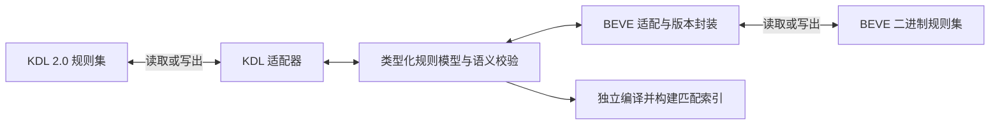

# KDL 与 BEVE 规则集互转

状态：已实现有限的 v1 谓词规则集、KDL/BEVE 互转及顺序匹配；Linux 有独立转换命令，实验代理可将规则集用作阻断策略。更丰富的规则逻辑、动作与主配置加载仍为设计。格式依据见[规则集格式](../architecture/rule-set-format.md)与[决策 0006](../decisions/0006-rule-set-formats.md)。

## 当前支持的规则

文件需包含一次 `schema-version 1`、一次 `kind "predicate"`，以及零个或多个有序的 `rule` 节点：

```kdl
schema-version 1
kind "predicate"
rule type="domain-suffix" value="example.com"
rule type="ip-cidr" value="192.0.2.0/24"
```

每条规则仅有 `type`、`value` 两个字符串属性；未知节点、属性、类型、版本和缺失字段均失败。当前采用 Glaze DOM 的 KDL 语义：同一节点的重复属性以最后一个值为准；这是 KDL 属性处理方式，不适用于 BEVE 对象重复字段，后者会被拒绝。类型和属性应直接写清楚，不依赖重复项。

`domain-suffix` 只接受 ASCII 字母、数字、连字符及点分隔的合法标签，大小写归一化为小写；不做 IDNA 转换，不接受末尾点。匹配自身或以点为边界的子域，例如 `example.com` 匹配 `a.example.com`，不匹配 `badexample.com`。`ip-cidr` 接受 IPv4 或 IPv6 地址与前缀；匹配忽略地址中的主机位，保留原输入字符串作为转换内容。匹配输入须是明确的域名和/或数字 IP，不触发 DNS；IPv4 映射 IPv6 地址按 IPv6 匹配。输入缺失时该类规则不匹配，提供的无效输入返回错误。

集合按顺序返回第一条匹配规则的下标，也可用于判断是否有任一匹配；不包含出口动作。输入、输出均最多 1 MiB，每个集合最多 16,384 条规则，单个 BEVE 字符串最多 253 字节。当前顺序扫描实现没有构建索引或声称性能指标。

实验代理允许在启动时指定一个阻断集合：域名命中立即阻断；每个目标 IP（包括域名解析结果）在拨号前单独匹配，命中则不拨号。无匹配的 IP 可以直连，无效域名返回失败。加载或编译失败时服务器不会启动，策略不支持运行中更新。使用示例及限制见 [SOCKS5 说明](../architecture/protocols/socks5-mixed.md)。

## Linux 离线转换

按 [xmake 构建](../build/xmake.md)编译后，例如：

```sh
build/linux/x86_64/debug/nexus rule convert kdl beve input.kdl output.beve
build/linux/x86_64/debug/nexus rule convert beve kdl output.beve restored.kdl
```

必须显式给出来源和目标格式，输入为普通文件，输出必须是尚不存在的新路径；不会覆盖已有文件、符号链接或输入硬链接。程序先解析、编码并重读验证，然后在输出目录内的私有临时目录完成写入，最后通过同一文件系统的硬链接原子发布；文件权限最多为 `0600`，还受进程 umask 限制。不支持硬链接的文件系统会报告失败。正常错误路径清理临时文件；进程被强制终止可能留下私有临时目录。没有调用 `fsync`，因此不承诺断电后的持久性。诊断写入标准错误；目前没有覆盖选项、标准输入输出或 Windows/macOS 转换程序。

## 单一语义模型

两个格式表达同一套类型化规则中间表示。当前模型只包含上述谓词；后续的逻辑组合与动作/引用须分别定义。共享校验器负责语义；两个独立适配器负责 KDL 结构和 BEVE wire profile，不能仅把任意 KDL AST 序列化后称为 Nexus 二进制规则集。



KDL 与 BEVE 文件均可作为加载源，通过同一校验后构建执行模型。转换是离线数据操作，不需要启动监听器、访问 DNS 或修改系统网络；解析和检查不执行规则动作。

## 两个方向

| 方向 | 流程与保证 |
| --- | --- |
| KDL → BEVE | 解析 KDL → 检查版本/字段/规则 → 形成规范模型 → 编码 BEVE 并封装 → 验证输出结果 |
| BEVE → KDL | 检查容器/编码/长度 → 解码 → 相同语义校验 → 输出规范化 KDL；当前没有压缩 |

互转保留当前支持的谓词、顺序和首命中行为。AND/OR/NOT、动作和附加元数据尚不受支持；未来扩展时不能为了压缩排序规则、改变短路行为或丢弃未知条件。

文本注释、空白、引号选择、排版和原始数字拼写不属于互转保证。所读 Glaze 分支 `docs/kdl.md` 提供 read/write 接口及动态文档模型，但不承诺保存文本排版；因此反向结果是规范化规则文本。需要原样编辑时另行保存源文件，不从 BEVE 推断原始源码。

编译后的 trie、区间索引、正则程序或机器相关缓存不能作为唯一 payload，否则可能无法恢复文本规则。正式二进制保留足以重建 KDL 的规则模型；可选索引只作为可丢弃加速区段。压缩、归并或优化若不可逆，就不得移除其依赖的规范规则表示。

## Glaze 接入与 schema

复用用户指定分支的 KDL 与 BEVE 能力，采用返回错误的读写接口，由 Nexus 适配层转换错误。项目已固定 `fc646588635c42cca142562d7b3d0484cc4493b7` 并通过当前子集的模块构建及往返测试；这不表示整个 Glaze 格式能力已经验证，内存分配失败等仍可能抛异常。

共享的是语义类型与稳定标识，不强制两种格式直接反射同一个内存布局。需要时定义各自 wire DTO，尤其是重复 KDL 节点、有序规则与二进制紧凑数组；禁止依赖默认 C++ 类名、成员顺序或 variant 下标作为外部 schema。

规则 schema 和主配置 schema 分开；[配置草案](spec.md)使用具名谓词规则集引用展示候选节点，尚未冻结。KDL 语言版本、规则 schema、BEVE profile、容器格式与可选索引版本分别管理。

## 失败、文件与诊断

未知必要特征、条件/动作、版本及无法表示的类型明确失败；不能悄悄降级、删除规则后报成功。未知可选元数据必须有保留/丢弃政策，只有政策允许且不影响语义时才可处理。拒绝部分成功文件作为有效规则集发布。

当前命令先在内存完成受限转换与验证，再以新文件方式发布，拒绝覆盖已有目标，从而保护输入及其硬链接。若未来支持覆盖或标准输入/输出，须分别定义保护与诊断策略。

限制输入/解压字节、条目、字符串总量、嵌套深度和工作量，峰值预算覆盖模型与输出副本。报错包含输入路径、规则序号/字段路径、阶段与原因；KDL 字节偏移和 BEVE 区段偏移按实际解析能力提供，不虚构行列。转换不自动下载远程规则或隐式覆盖用户文件。

## 验收

保存跨版本黄金样本，分别验证：

- `KDL → BEVE → KDL` 重读后的规范模型相同，规则顺序和默认值语义不变。
- `BEVE → KDL → BEVE` 解码后的规范模型等价，不要求未经定义的字节级完全相同。
- 两种输入构建的执行模型对同一流量样本给出相同匹配结果；不能只证明序列化可往返。
- 嵌套逻辑、重叠域名/IP、边界端口、空集合、重复项、IPv4/IPv6 及显式缺省各有样本；实际仅测试声明支持的规则类型。
- 不支持版本/规则、未知必需字段、截断、尾随数据、畸形长度、超预算和写入失败都有明确错误，失败不留下正式输出或破坏原文件。

目前有手工构造的 v1 BEVE 样本、两向语义往返、匹配结果及文件失败路径测试；完整跨版本兼容、其他平台及性能仍待验证。若后来定义确定性编码或签名，再增加字节级稳定性与签名覆盖测试。[示例规则集](examples/README.md)可被规则组件读取；主配置仍不可运行。
