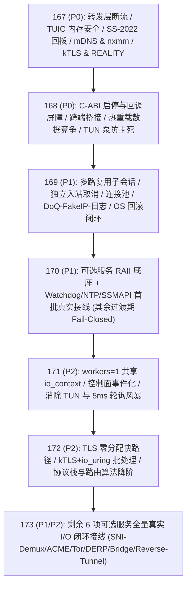

# 第 167–173 批规划：内核生命周期合规加固、事件驱动收敛、零拷贝激活与全量服务真实接线

更新时间：2026-11-23

本轮规划基于对 Nexus 非 GUI 核心代码（[src/](../../src/)、[include/nexus/core_c_api.h](../../include/nexus/core_c_api.h) 及跨平台核心桥接层）的全量生命周期与性能审查结果，对照 [核心架构设计原则](../design-principles/core-architecture.md)、[组件模型](../architecture/component-model.md) 与 [并发与多线程架构](../architecture/concurrency.md) 制定。

核心落地原则：
1. **先 P0 止血、再 P1 闭环、后 P2 性能跃升，最终全部可选服务实现真实 I/O 闭环接线**（过渡期对尚未完成接线的服务实行显式 Fail-Closed 拒绝静默空跑，直至第 173 批全部接线完成并解除拦截）。
2. **默认 `workers=1` 多普通入站与本地控制面收敛至共享 `corosio::io_context`**，保持单线程串行所有权模型不变，`workers > 1` 保持每 worker 独立线程与 `SO_REUSEPORT` 隔离不变。
3. **每批独立可编译、独立补充回归测试、独立通过门禁**：所有手写源文件严格保持 `<= 500` 行（目标 `<= 300` 行）、`src/` 下零 `.hpp`、`mcpp/epoll/mcpp.lock` 摘要不变、无禁用词或本机绝对路径残留。

---

## 一、总体依赖路线图

---

## 二、批次拆解

| 批次 | 优先级 | 主题 | 核心改动范围 | 验收标准 | 状态 |
| :--- | :--- | :--- | :--- | :--- | :--- |
| **167** | **P0** | **协议转发稳定性、QUIC/TUIC 内存安全、路由与加密边界** | A. [xhttp_http3_listener.cppm](../../src/relay/xhttp_http3_listener.cppm)：`Xhttp3Inbound::Bundle` 设置 `parent.relaying = true` 并刷新 `touched`，修复活跃 QUIC 连接 10 秒被握手超时误杀。 B. [tuic_inbound.cpp](../../src/relay/tuic_inbound.cpp) 与 [application.cppm](../../src/tuic/application.cppm)：`TuicHost::Impl::Worker` 析构补齐 `routing.stop()` 消除启动半失败 UAF，校正 `pump_worker` 停机顺序；`release_stream` 延迟释放未排空 `s->tx` 防重传队列 UAF，并在 `stream_close`/`stream_reset`/`stop_sending`/`connection_closed` 回收中止或已关闭单向流槽位消除 64 槽耗尽。 C. [replay.cpp](../../src/shadowsocks/replay.cpp)：SS-2022 `ReplayTable` 遇到系统墙钟相对单调时钟回拨时通过安全冷却重锚恢复，杜绝永久锁死同时保留全部防重放不变量。 D. [dns_mdns_transport.cpp](../../src/tools/dns_mdns_transport.cpp) 与 [mdns.cppm](../../src/dns/mdns.cppm)：新增域名归一化比对 `same_name`，过滤无关局域网 mDNS 报文并继续等待真实响应。 E. [rules.cppm](../../src/rules/rules.cppm)、[program.cpp](../../src/rules/program.cpp)、[mmap_ruleset.cpp](../../src/rules/mmap_ruleset.cpp) 与 [route_files.cpp](../../src/tools/route_files.cpp)：修复 `LegacyRouteProgram` 丢失 `RouteRule::mmap` 导致空谓词全匹配，将 `.nxmm` 映射字节纳入 8 MiB 总预算并加强映射边界防截断安全。 F. [ktls.cpp](../../src/tls/ktls/ktls.cpp)、[client_flight.cppm](../../src/tls/client_flight.cppm)、[client_flight.cpp](../../src/tls/client_flight.cpp)、[server_auth.cppm](../../src/reality/server_auth.cppm) 与 [server_profile.cppm](../../src/reality/server_profile.cppm)：kTLS 检查 `MSG_CTRUNC`、`ApplicationRecords` 析构/移动清零 `handshake_pending_`、REALITY `ServerProfile` 接入有界 `ReplayCache`。 | 新增并跑通 SS-2022 回拨恢复、mDNS 过滤、`.nxmm` `LegacyRouteProgram`、kTLS `MSG_CTRUNC`、REALITY 防重放与 TUIC 70 次连续单向流回收回归；既有核心单测与仓库质量门禁全绿。 | 已完成 |
| **168** | **P0** | **嵌入式 C-ABI 屏障、跨端桥接、热重载数据竞争与 TUN 泵可靠性** | A. [core_c_api.cpp](../../src/tools/core_c_api.cpp)、[proxy_run.cppm](../../src/tools/proxy_run.cppm)、[main.cpp](../../src/tools/main.cpp)、[route_files.cpp](../../src/tools/route_files.cpp)、[rule_fetch.cpp](../../src/tools/rule_fetch.cpp)：消除 `start()` 与 `request_stop()` 竞态、全部 `extern "C"` 加 `try/catch` 异常防火墙、公共化 `-D/--directory` 解析修复 Apple 5 参数启动、`g_working_directory` 加锁并消除跨模块静态初始化注册、嵌入式不覆盖宿主信号处理器（CLI RAII 恢复）。 B. 跨端桥接：[CoreProcessSupervisor.kt](../../android/core-bridge/src/main/kotlin/org/nexus/android/bridge/core/CoreProcessSupervisor.kt)、[TunFdSocketServer.kt](../../android/core-bridge/src/main/kotlin/org/nexus/android/bridge/vpn/TunFdSocketServer.kt) 与 [tun_cli.cpp](../../src/tools/tun_cli.cpp) 清理失效 `NEXUS_TUN_FD` 并落地 `NEXUS_TUN_FD_SOCK` `SCM_RIGHTS` 传递；Windows [core_supervisor.cpp](../../desktop/src/core_supervisor.cpp) 与 `WinStopEventGuard` 停机优先命名事件优雅排空再超时强杀。 C. [tun_bridge.cppm](../../src/platform/tun_bridge.cppm)、[socket_protect.cpp](../../src/platform/socket_protect.cpp)、[tun_linux.cpp](../../src/packet/tun_linux.cpp) 与用户态 `tcp/udp::Direct4/6`：`ExternalTunBridge` 与 `ProtectSlot` 增加在途引用计数与排空屏障；修复 `set_external_tun_fd` `adopt=true` FD 泄漏与 `borrow` 模式 `O_NONBLOCK` 污染恢复；用户态直连补齐 `invoke_protect_fd`。 D. [fd.cppm](../../src/packet/fd.cppm)、[fd_posix.cppm](../../src/packet/fd_posix.cppm)、[tun_device_runtime.cppm](../../src/tools/tun_device_runtime.cppm)、[tun_host.cpp](../../src/tools/tun_host.cpp) 与 [proxy_host.cppm](../../src/tools/proxy_host.cppm)：非临时写错误立刻 `output.reset()`；透传致命设备 I/O 错误使设备撤销快速暴露不健康；限制 `udp_replies` 容量、`pump_loop` 捕获 `std::bad_alloc`、接入 `ProxyHost` 排空。 E. [proxy_providers.cpp](../../src/tools/proxy_providers.cpp) 与 [proxy_dns_reload.cppm](../../src/tools/proxy_dns_reload.cppm)：消除热重载对 `manifest_`/`base_dir_`/`entries_` 的数据竞争；`std::stop_token` 穿透远端 HTTPS 拉取实现停机秒断；补齐 `file` provider mtime 轮询与热重载补启后台线程。 | C-ABI 并发启停与 `-D` 5 参数测试、回调排空屏障压测、TUN 丢包/撤销/`NEXUS_TUN_FD_SOCK` 单测、`file` mtime 与并发热重载回归及 Desktop CTest 2/2 全绿（注：当前容器无 JDK 未跑 Gradle 离线单测）。 | 已完成 |
| **169** | **P1** | **多路复用子会话、独立入站、连接池、DNS/持久化/日志与 OS 回滚闭环** | A. 抽取统一子 `Session` 工厂接入 6 类多路复用入站（`trojan_inbound_grpc`/`mux_inbound`/`anytls_inbound`/`grpc_vless_inbound`/`xhttp_http2_server`/`naive_inbound_helpers`），一致继承 `fakeip`、`runtime_mode`、`direct_buffers` 与 `SessionQuota`，补齐 `mux_inbound` 流头超时与防饥饿。 B. 修复 `FixedUdpInbound` 串行写队列/`touched`/直连关闭、`ModernHttp3Inbound` (`CONNECT-UDP`) 双向取消传播、`ShadowTLS` decoy 握手取消。 C. Mux/gRPC/SSH/Naive 连接池补空闲 `reap` 与建连绑定 `current_route_snapshot()`；`ssh::Session` 关闭超时回收槽位并清空 `rx`；修复 OpenVPN/OpenConnect 死 `Host` 窗口、握手密钥 `crypto::cleanse` 与 `static-key-file` 处置。 D. DoQ 新增 `stop_quic_queries` 并在 4 处补全 DoQ/DoT 停止；`system_local_snapshots()` 改为可停机引用计数实例；`DnsMessageRuntime::save_checkpoint()` 与 DHCP leases 读出热循环；`FakeIpStore` 增显式 `flush()/stop()`；缓存锁短暂退避与 Windows 重解析点校验；`logging::Runtime` 按线程分配独立 SPSC 槽位消除并发静默丢日志。 E. 修复 `nftables::Table` 关 `socket_`、`StrictTunOwner` 回滚预算与超时 `SIGKILL+waitpid`、Darwin/Windows 路由 `EEXIST` 不误删及清理 IP、`system_proxy` 快照还原与 `posix_spawn`。 | 多路复用入站继承/配额回归、DoQ/DoT 停机 `< 500ms`、`FakeIpStore::stop()` 刷盘测试、多线程日志零静默丢失单测、OS 回滚单测全绿。 | 已完成 |
| **170** | **P1** | **可选服务 RAII 底座与首批真闭环（Watchdog / NTP / SSMAPI）** | A. [proxy_services.cpp](../../src/tools/proxy_services.cpp)：消除裸 `new`，改为 RAII 所有权与 `stop()` 严格逆序析构。 B. `memory-watchdog`：修复恢复 `normal` 时状态复位，接入真实 `soft`/`hard` 缓冲池/连接池/DNS 缓存裁剪与 `emergency` 新会话准入控制。 C. `ntp`：首轮同步异步化防阻塞启动、UDP 接 `invoke_protect_fd` 防 VPN 回环、`global_calibrator()` 接入 SS-2022/REALITY 时间源。 D. `ssmapi`：[ssmapi_bridge.cpp](../../src/control_api/ssmapi_bridge.cpp) 补齐 `u_psk` 析构 `crypto::cleanse`，并将 `UserStore` 真实接入 Shadowsocks-2022 TCP/UDP 入站动态多用户鉴权与字节统计。 E. 对将在第 173 批接线的 6 项服务（`sni-demux`/`acme`/`tor`/`derp-server`/`bridge`/`reverse-tunnel`）在过渡期实行显式 Fail-Closed 报错，杜绝静默空跑。 | `watchdog` 驱逐与准入单测、`ntp` 异步+`protect_fd` 单测、`ssmapi` 动态增删用户实时生效集成测试、未接线项过渡期明确拒启验证通过。 | 已完成 |
| **171** | **P2** | **事件驱动架构收敛与轮询风暴清零** | A. [server_interface.cppm](../../src/relay/server_interface.cppm)、[server_runtime.cpp](../../src/relay/server_runtime.cpp)、[routing_context.cpp](../../src/relay/routing_context.cpp)、[proxy_host.cppm](../../src/tools/proxy_host.cppm)、[proxy_listener.cppm](../../src/tools/proxy_listener.cppm)、[proxy_listener_reload.cppm](../../src/tools/proxy_listener_reload.cppm) 与 [proxy_run.cppm](../../src/tools/proxy_run.cppm)：`Server` 支持借用共享 `io_context`，`workers=1` 下全部普通入站及热重载旧代共享唯一 `corosio::io_context`，单监听器安全退出不波及共存共享监听器。 B. [http_server.cpp](../../src/control_api/http_server.cpp)、[types.cppm](../../src/control_api/types.cppm)、[control.cppm](../../src/tools/control.cppm)、[proxy_control_wake.cppm](../../src/tools/proxy_control_wake.cppm) 与 [proxy_http_control.cppm](../../src/tools/proxy_http_control.cppm)：监听/自管道 FD 接入事件桥消除 20ms 轮询；按 `SnapshotFields` 延迟按需构造快照；消除 `/v1/connections/{id}` 96 条截断误报 404；SSE 写活跃自动续期。 C. [tun_host.cpp](../../src/tools/tun_host.cpp)、[tun_event_wait.cppm](../../src/tools/tun_event_wait.cppm)、[tun_udp.cppm](../../src/tools/tun_udp.cppm)、[tun_fakeip.cppm](../../src/tools/tun_fakeip.cppm)、[engine.cpp](../../src/tcp/engine.cpp) 与 [tun_bridge.cppm](../../src/platform/tun_bridge.cppm)：`step_tcp()` 仅定向唤醒变更流；TUN fd / 直连 UDP `epoll` / `ExternalTunBridge` 接入事件驱动，消除 `sleep_for(1ms)` 与全量扫描。 D. [ordered_sender.cpp](../../src/udp-runtime/ordered_sender.cpp)、[stream_datagram_reply.cppm](../../src/net/stream_datagram_reply.cppm)、[stream_datagrams.cppm](../../src/net/stream_datagrams.cppm)、[server_io.cppm](../../src/xudp/server_io.cppm)、[vless_mux.cppm](../../src/relay/vless_mux.cppm)、[tailscale_endpoint.cpp](../../src/tools/tailscale_endpoint.cpp)、[l3_mux.cppm](../../src/relay/l3_mux.cppm) 与 [openconnect_outbound.cpp](../../src/relay/openconnect_outbound.cpp)：全部 5ms 固定轮询替换为 `capy::async_event`、`epoll` 描述符等待与精准 `min(expires)` 休眠。 | 已通过 [batch171_event_loop_unit.cpp](../../tests/batch171_event_loop_unit.cpp)、`core-c-api-unit`、`batch170-services-unit`、`batch168-services-cli-unit`、`batch189-tun-cross-platform-unit`、`vpn-runtime-unit`、`profile-linux-epoll,tailscale-endpoint`、`profile-sidecar` 与 `batch131` 并发/热重载/FD 零泄漏压测。 | 已完成 |
| **172** | **P2** | **数据面零拷贝快路径激活与热点算法降阶** | A. [driver.cppm](../../src/http2/driver.cppm)、[tls_server.cppm](../../src/vless/tls_server.cppm)、[corosio_server.cppm](../../src/vless/corosio_server.cppm)、[session.cppm](../../src/ssh/session.cppm)、[stream_relay.cppm](../../src/net/stream_relay.cppm)、[vless_inbound.cpp](../../src/relay/vless_inbound.cpp)、[trojan_inbound_common.cpp](../../src/relay/trojan_inbound_common.cpp)：TLS 读缓冲统一提升至 `16640 >= kMinDirectReadBuffer (16624)` 解锁零分配直解；扩展 `try_enable_ktls()` 至纯 TLS 的 VLESS/AnyTLS/Trojan 客户端与入站；[session.cpp](../../src/relay/session.cpp) 改用 `meters_principal_bytes()` 保留非计费用户 `splice`，[session_splice_linux.cpp](../../src/relay/session_splice_linux.cpp) 经 1w 1S/16S 压测验证维持 `kYieldBurst = 256 KiB`（单流 `1 MiB` / 多流 `256 KiB` 兼顾公平性与吞吐）且 [server_runtime.cpp](../../src/relay/server_runtime.cpp) `prepare_poll()` 在存在空闲 pipe 时及时唤醒回收；SS-2022 UDP 入站接入 `platform.udp_batch` `recvmmsg` 批收，Linux TUN 在 `NEXUS_ENABLE_IO_URING` 下接入 `UringMultishotLoop::arm_read_multishot` + `FdPump::step_output`（不支持时自动回退）。 B. [packet.cppm](../../src/packet/packet.cppm)、[memory.cpp](../../src/packet/memory.cpp)、[switch.cpp](../../src/packet/switch.cpp)、[engine.cpp](../../src/tcp/engine.cpp)、[tun_udp_reply_fragments.cppm](../../src/tools/tun_udp_reply_fragments.cppm)：新增强异常安全 `MemoryLink::send_owned(Side, Bytes&&)` 零拷贝移动重载；[dispatch.cpp](../../src/tcp/dispatch.cpp) 消除推测性伪 ACK 构造；[bridge.cpp](../../src/udp/bridge.cpp)、[route.cpp](../../src/udp/route.cpp)、[tun_udp.cppm](../../src/tools/tun_udp.cppm) 消除重复解包与空策略格式化；[ipv4.cpp](../../src/packet/ipv4.cpp)/[tcp4.cpp](../../src/packet/tcp4.cpp)/[ipv6.cpp](../../src/packet/ipv6.cpp)/[tcp6.cpp](../../src/packet/tcp6.cpp) 改为 64 位延迟折叠校验和；[receive.cpp](../../src/tcp/receive.cpp) 以 16 项有序 SACK 区间表替代 `present_` 位图，[connection.cpp](../../src/tcp/connection.cpp) 在 `TIME_WAIT` 立即释放收发缓冲；[openconnect_outbound.cpp](../../src/relay/openconnect_outbound.cpp) 与 [openvpn_transport.cppm](../../src/relay/openvpn_transport.cppm) 改为 $O(1)$ 读游标消费。 C. [route_matcher.cpp](../../src/rules/route_matcher.cpp)、[program.cpp](../../src/rules/program.cpp)、[matcher_eval.cpp](../../src/rules/matcher_eval.cpp)：`RouteMatcher::preflight` 与 `RouteProgram::preflight` 降至 $O(\log N)$；[process_owner_linux.cpp](../../src/platform/process_owner_linux.cpp) 接入 `NETLINK_SOCK_DIAG` 及 `need_process=false` 免 `/proc` 快路径，[tun_owner_lookup.cppm](../../src/tools/tun_owner_lookup.cppm) 增加 1024 项 5s TTL UDP 归属缓存；[udp.cpp](../../src/udp/udp.cpp) `BasicFlowTable` 改为 $O(1)$ LRU 过期；[ordered_sender.cpp](../../src/udp-runtime/ordered_sender.cpp) 复用多路复用槽位，[stream_datagrams.cppm](../../src/net/stream_datagrams.cppm) 与 [session_udp_types.cppm](../../src/relay/session_udp_types.cppm) 解除 16 槽截断扩至 128 惰性槽；[group_snapshot.cppm](../../src/dns-shared/group_snapshot.cppm)/[group_snapshot_lookup.cpp](../../src/dns-shared/group_snapshot_lookup.cpp) 缺失时无锁检查跨组；[rule_watch_client.cppm](../../src/tools/rule_watch_client.cppm)/[rule_fetch.cpp](../../src/tools/rule_fetch.cpp) RAII 复用 `NamedHttpClient`；[reload.cpp](../../src/config/reload.cpp) 单次 KDL 解析 `reload_identities`。 | 已通过 [batch172_fastpath_unit.cpp](../../tests/batch172_fastpath_unit.cpp)、21 项根单测、45 项 `tests/tun` 单测、`core-c-api-unit`、`batch123-tcp-udp-datapath-unit`、`batch96b-ktls-unit`、`batch189-tun-cross-platform-unit`、`batch171-event-loop-unit`、`vpn-runtime-unit`、`batch187`/`188`/`166`/`167`/`168`/`170`、`tests/udp-runtime` 夹具构建、`profile-linux-epoll,tailscale-endpoint` + `profile-linux-uring` + `profile-sidecar` 三 profile 全量构建与 `batch131` 并发/热重载/FD 零泄漏压测。 | 已完成 |
| **173** | **P1/P2** | **剩余 6 项可选服务全量真实 I/O 闭环接线** | 逐一补齐真实网络监听/数据面/TLS 闭环并移除第 170 批全部过渡期 Fail-Closed： A. [svc_sni_demux.cpp](../../src/tools/svc_sni_demux.cpp)：真实前置 TCP 监听器 + ClientHello SNI/ALPN 窥探 + 原始未改写字节透明双向转发至匹配规则/回退上游。 B. [svc_acme.cpp](../../src/tools/svc_acme.cpp)、[server_credential.cppm](../../src/tls/server_credential.cppm) 与 [server_credential.cpp](../../src/tls/server_credential.cpp)：真实 HTTP-01（`/.well-known/acme-challenge/`）/ TLS-ALPN-01（`acme-tls/1` TLS 1.3 握手）/ DNS-01 挑战响应器 + HTTP/HTTPS ACME 客户端 + 持久化 P-256 账户密钥 + 定时自动续签线程 + 线程安全 `tls::AtomicServerCredential` 原子热更新与热更新回调。 C. [tor_tunnel.cpp](../../src/relay/tor_tunnel.cpp)、[tor_api.cpp](../../src/relay/tor_api.cpp)、[svc_tor.cpp](../../src/tools/svc_tor.cpp)、[route_resolve.cpp](../../src/relay/route_resolve.cpp) 与 [dial.cpp](../../src/relay/dial.cpp)：`relay::Server::add_tor` 真实接入出站拨号工厂，支持 RFC 1929 每流独立电路隔离、`TunnelFactory::remote_domain_dial` 零本地 DNS 泄漏 `.onion`/域名直连，及真实 ControlPort `AUTHENTICATE`/`SIGNAL NEWNYM`/`GETINFO` 客户端。 D. [svc_derp.cpp](../../src/tools/svc_derp.cpp)：真实 HTTP/HTTPS（TLS 1.3）+ `Upgrade: DERP` + RFC 6455 `Upgrade: websocket`（含 `/generate_204`）DERP 中继监听完整接入 `DerpRelayServer` 状态机与两节点加密报文转发。 E. [svc_bridge.cpp](../../src/tools/svc_bridge.cpp)：事件驱动 `poll()` 双向 L3 数据包泵打通 Linux TUN 与 `AF_PACKET` 物理网卡（含 IPv4 TTL/校验和更新、IPv6 HopLimit、链路本地/防环路过滤与可测试 FD 注入入口）。 F. [svc_reverse_tunnel.cpp](../../src/tools/svc_reverse_tunnel.cpp)：服务端/客户端双向控制通道（令牌认证、心跳超时与重连复位）+ 多路复用并发 TCP 流转接本地/远端暴露端点。 | 已通过 [batch173_services_e2e_unit.cpp](../../tests/batch173_services_e2e_unit.cpp)、[batch173_acme_derp_e2e_unit.cpp](../../tests/batch173_acme_derp_e2e_unit.cpp)、[batch168_services_cli_unit.cpp](../../tests/batch168_services_cli_unit.cpp)、[batch170_services_unit.cpp](../../tests/batch170_services_unit.cpp)、8 项 `config` 单测、`profile-linux-epoll,tailscale-endpoint` + `profile-linux-uring` + `profile-sidecar` 三 profile 全量构建与 `batch131` 并发/热重载/FD 零泄漏压测，零空壳服务残留。 | 已完成 |

---

## 三、每批统一质量门禁

每完成一个批次，须在继续下一批前完成以下核验：
1. 本批对应单元/集成回归测试全绿；
2. `bash scripts/check-source-lines.sh` 全部通过（严禁新增超过 500 行的手写源文件，严禁在 `src/` 引入 `.hpp`）；
3. `git diff --check` 无空白错误；
4. `sha256sum mcpp/epoll/mcpp.lock` 维持不变；
5. 负向审计确保文档与核心代码无禁用品牌词或本机路径残留；
6. 及时更新本文档各批次状态列。
