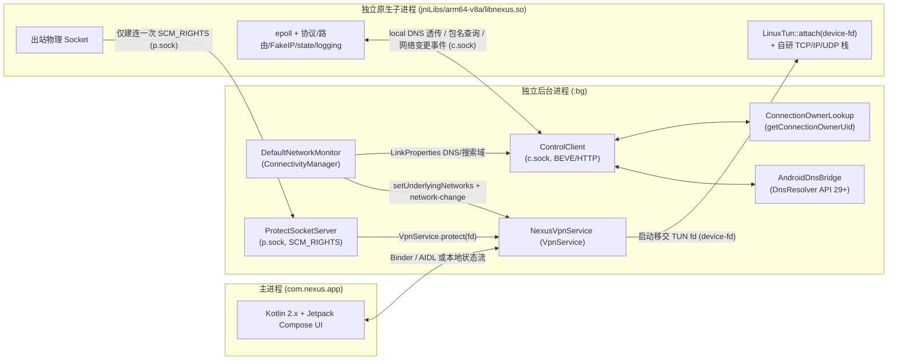

# Nexus Android 免 Root 系统交互与工程落地指南

更新：2026-11-20。本文面向 **Android 10–16（API 29–36，无 Root）**，结合 Android 系统网络栈机制，系统性梳理 Nexus 以 **Kotlin 2.x + Gradle（Wrapper / Kotlin DSL / Version Catalog）外壳 + `aarch64-linux-musl` 静态原生 Sidecar** 形态落地时，在 **DNS、VpnService、网络切换、分应用路由、UDS 桥接、省电保活与工程构建** 各层面的详细方案与避坑清单。

---

## 1. 总体进程与通信拓扑



### 为什么这套拓扑在 Android 免 Root 下既稳又快
1. **数据面零跨进程/零 JNI 损耗**：TUN FD 只在启动时交接一次；`protect(fd)` 只在新建物理出站 socket 时经文件系统 UDS 走一次 `SCM_RIGHTS`（~20–50 µs；H2/XHTTP/QUIC/WG 多路复用下整条隧道仅调用 1 次）。所有收发包 100% 在原生进程与 Linux 内核间直通，不触发 ART 堆分配与 GC 抖动。
2. **三层崩溃与内存隔离**：UI 进程随时可被系统回收；`:bg` 进程轻量守护 `VpnService` 与生命周期；`libnexus.so` 原生子进程独立受 `memory::Budget` 约束（移动端建议 32–64 MiB 上限），异常退出时 `:bg` 进程立即接管日志收集、安全退避重启或撤销 VPN，杜绝“假死断网”。
3. **100% 统一 Clang（`llvm@23.1.6`）+ C++26 Modules + 静态 `libc++`**：原生侧由 Clang 交叉编译 `aarch64-linux-musl` 静态可执行文件（零 `-freflection`、零 `libstdc++` 动态依赖），同时产出 Linux ARM64 静态单文件发行版。

---

## 2. DNS 与 Android 系统交互（最核心、坑最多）

免 Root Android DNS 必须把 **“接管入站 DNS”**、**“本地物理网解析（`local`）”**、**“Private DNS (DoT) 边界”** 和 **“缓存/FakeIP 协同”** 四条链路全部打通。

### 2.1 入站 DNS 接管：`VpnService.Builder.addDnsServer`
- **基本原则**：调用 `builder.addDnsServer(...)` 指定一个**必定落入 TUN 路由范围内的哨兵 DNS IP**（推荐 `tun.inet4_address` 网段内的对端地址，例如 TUN 地址 `172.19.0.1/30`，DNS 设 `172.19.0.2`；双栈则加 `fdfe:dcba:9876::2`）。
- **避坑**：
  - 绝不要把 `addDnsServer` 设成 `127.0.0.1` 或路由器局域网 IP（如 `192.168.1.1`），否则开启 `route-exclude-private` 时 DNS 包会绕过 TUN 导致全局解析失效或泄露；
  - 若开启 IPv6 TUN，建议同时提供 IPv4 和 IPv6 哨兵 DNS，防止纯 IPv6 环境下 Android 拒绝把 DNS 发进 TUN；
  - 在 Nexus 侧继续通过有序路由 `hijack-dns` 精准拦截目的端口 53 的 UDP/TCP 流量（且受 93C 防源端口复用误劫持 STUN 保护）。

### 2.2 本地物理网解析（`local` DNS）：`DnsResolver` 平台桥接
Android 免 Root 沙箱既没有 `/etc/resolv.conf`，又在 VPN 启动后面临运营商 DNS64/NAT64、Wi-Fi Captive Portal（酒店/校园网登录页）、企业内网域名和代理节点自身域名解析（bootstrap）四大刚需。

采用平台本地解析器桥接方案可天然适配 UDS Sidecar：

| Android 版本 | Kotlin 侧系统 API | 能力与优势 |
| --- | --- | --- |
| **Android 10+（API 29+，主力）** | `DnsResolver.getInstance().rawQuery(underlyingNetwork, wireBytes, flags, executor, cancelSignal, callback)` | **官方最优解**：直接收发原始 RFC 1035 wire 报文（完整支持 A/AAAA/HTTPS/SVCB/TXT/SRV），显式绑定到 **`underlyingNetwork`（非 VPN 物理网）** 天然防回环，自动继承 Captive Portal、企业内网搜索域、DNS64/NAT64，且支持 `CancellationSignal` 透传超时取消。 |
| **Android 9 及以下（API ≤ 28，兼容）** | `underlyingNetwork.getAllByName(domain)` | 仅支持 A/AAAA，封装标准响应报文返回给内核。 |

- **在 Nexus Sidecar 中的落地协议**：
  - 在 `c.sock`（或独立轻量 `d.sock`）上定义一个简单长度前缀帧：`[4B req_id][4B timeout_ms][2B wire_len][wire_bytes]` → 回包 `[4B req_id][1B status][4B err_code][2B resp_len][resp_bytes]`；
  - Nexus 的 `local` DNS transport 新增可选 `android-bridge-socket` 后端：仅当路由命中的是 `local` 解析器（例如 bootstrap 解析节点域名、Captive Portal 探测域名、企业内网后缀）时走此 UDS 桥，日常 DoH/DoT/DoQ/DoH3 仍由 Nexus 原生直连（走 `protect(fd)`），不经过 Kotlin 层。
  - **额外补充 `LinkProperties` 推送**：Kotlin 侧在 `onLinkPropertiesChanged` 中把底层物理网的 `linkProperties.dnsServers` 与 `linkProperties.domains`（搜索域）同步推送给 Nexus，供 `local` 规则判断（如 `search-domain` 补全）和诊断展示。

### 2.3 Android Private DNS（DoT / TCP 853）的现实边界与打磨
这是 Android 免 Root VPN **最容易被用户误报为“漏 DNS / 分流失效”** 的系统机制：
- **严格模式（用户手动填了 DoT 主机名，如 `dns.google`）**：Android `netd` 会直接把系统 DNS 请求封装成 TLS（TCP 853）发往该主机。
  - 若 `VpnService` 拦截了 `0.0.0.0/0`，部分系统版本/场景下 853 流量会进 TUN（此时若 Nexus 没对 853 特殊处理，FakeIP 永远拿不到域名，且直连 853 可能被墙导致全机断网）；在另一些策略下 `netd` 会走底层物理网绕过 TUN。
- **自动模式（Opportunistic，Android 默认）**：Android 会探测 VPN 声明的 DNS 服务器是否支持 853；由于我们的 TUN 哨兵 IP（如 `172.19.0.2`）拒绝 853 端口，Android 会自动回退到明文 53 端口并顺利进入 Nexus `hijack-dns`。
- **工程打磨清单**：
  1. **状态感知与 UI 提示**：通过 `LinkProperties.isPrivateDnsActive()` 和 `LinkProperties.privateDnsServerName`（非空即表示处于严格模式）实时检测；当检测到严格模式且配置启用了 FakeIP 或精细 DNS 分流时，在 UI 顶栏给出清晰提示（建议切回“自动”或“关闭”），避免静默异常；
  2. **853 端口保护策略**：对发往 TUN 哨兵 DNS IP 的 TCP 853 连接**立即返回 TCP RST（而非静默丢弃等待超时）**，让 Android 自动模式在 1ms 内快速回退到 UDP/TCP 53，避免每次切网出现 3–5 秒首包卡顿！

### 2.4 系统 DNS 缓存与 FakeIP 协同
- Android `netd`、Chromium/WebView、OkHttp 都会缓存 DNS 结果；如果 VPN 停止或切换配置后，App 仍持有旧 FakeIP（`198.18.0.0/15`），会出现几分钟内访问失败。
- **三道保险**：
  1. Nexus 给客户端返回的 FakeIP 响应 **TTL 固定设为极短值（推荐 1–5 秒）**；
  2. VPN 启动、配置重载、停止前后，Kotlin 侧更新 `setUnderlyingNetworks` 触发系统网络状态刷新，促使各 App 与 `netd` 失效旧 DNS 缓存；
  3. 配合 Nexus 第 92C 批已实现的 **FakeIP 持久化（`state.fakeip` 段预留 + WAL）**，即使 `:bg` 进程或原生进程重启，既有域名 ↔ FakeIP 映射依然保持连续不失效！

---

## 3. `VpnService.Builder` 精细化配置与版本兼容

非 Root `VpnService.Builder` 的每个参数都直接影响稳定性与兼容性：

| 配置项 | Android API 要求 | 推荐做法与避坑 |
| --- | --- | --- |
| **排除自身应用** | 全版本 | **必须无条件调用** `builder.addDisallowedApplication(context.packageName)`（即使白名单模式也不能把自身放进允许列表），彻底杜绝应用自身控制/探测流回环。 |
| **非阻塞 TUN FD** | 全版本 | `builder.setBlocking(false)`，与 Nexus `epoll` + `LinuxTun::attach(fd, adopt)` 直接匹配；Kotlin 侧 `establish()?.detachFd()` 移交或 `dup` 后管理生命周期，绝不双重 `close`。 |
| **路由排除（`route-exclude`）** | API 33+ 原生<br>API ≤ 32 需计算 | **Android 13+**：直接 `addRoute("0.0.0.0", 0)` + `excludeRoute(IpPrefix(...))`。<br>**Android 12 及以下**：无 `excludeRoute` API，必须先在用户态做 **CIDR 集合减法**（从 `0.0.0.0/0` 与 `::/0` 减去所有排除前缀，拆成不重叠子网），再逐条 `addRoute`。 |
| **IPv6 防漏策略** | 全版本 | 物理网有 IPv6 但 TUN 只接管 IPv4 时，IPv6 流量会直接旁路泄露！提供三选一明确策略：① 双栈接管（推荐，配 IPv6 地址 + `::/0`）；② 仅 IPv4 且阻断 IPv6 防漏（仍接管 `::/0` 并在 Nexus 侧快速 reject/ICMPv6 Unreachable）；③ 显式允许 IPv6 直连。 |
| **MTU 选择** | 全版本 | 纯用户态 TCP/IP 栈（TUN 仅本机内存收发）下可配 `9000` 降低 `read`/`write` syscall 频率；若发现部分旧 ROM/内核兼容性问题或需要精准模拟真实路径，回退保守值 `1500` 或 `1280`（464XLAT/移动网安全值）。 |
| **计费网络标记** | API 29+ | `builder.setMetered(false)` 或镜像当前物理网的 `!hasCapability(NET_CAPABILITY_NOT_METERED)`，防止 Wi-Fi 下系统误把 VPN 判为计费流量而暂停更新/同步。 |
| **底层网络绑定** | API 22+（13+ 强制） | 持续调用 `VpnService.setUnderlyingNetworks(arrayOf(activePhysicalNetwork))`；**断网时传 `emptyArray()` 而不是 `null`**（`null` 会让系统退回自动推断全部非 VPN 网络，易在切换期造成耗电与状态错乱）。 |
| **系统 HTTP 代理** | API 29+（可选） | 可选提供 `builder.setHttpProxy(ProxyInfo.buildDirectProxy("127.0.0.1", mixedPort, bypassList))`，让遵守系统代理的 HTTP/WebView 客户端直连 Nexus 本地混合入站，跳过 TUN 用户态 TCP 栈进一步降 CPU。 |
| **分应用代理** | 全版本 | `addAllowedApplication` 与 `addDisallowedApplication` 互斥；内置常用排除预设（本机投屏/局域网互联、运营商 VoWiFi/IMS、Android Auto 等），并注意正确处理 `PackageManager.NameNotFoundException`（已卸载包不能导致整次 VPN 启动失败）。 |

---

## 4. 网络切换（Wi-Fi ↔ 5G）与防回环机制

默认物理网络监控要点：

1. **只监听非 VPN 物理默认网**：
   ```kotlin
   val request = NetworkRequest.Builder()
       .addCapability(NetworkCapabilities.NET_CAPABILITY_INTERNET)
       .addCapability(NetworkCapabilities.NET_CAPABILITY_NOT_VPN)
       .build()
   ```
   - Android 12+（API 31+）优先用 `registerBestMatchingNetworkCallback` / `registerDefaultNetworkCallback` 避免多网卡（Wi-Fi + 蜂窝同时在线）时误切到非默认网卡；
   - 必须过滤掉自身 TUN 接口名，防止自触发死循环。
2. **切网三步动作（去抖 150–300ms）**：
   - **Step 1**：更新 `activePhysicalNetwork` 并调用 `vpnService.setUnderlyingNetworks(arrayOf(network))`；
   - **Step 2**：提取新 `LinkProperties`（物理接口名、MTU、DNS 服务器列表、搜索域、Private DNS 状态、是否计费），按 `(interfaceName, dnsServers)` 对比去重（避免无实质变化时误断流）；
   - **Step 3**：通过 `c.sock` 推送 `network-change` 事件给 Nexus 原生内核 → 内核刷新 `local` DNS 上游、触发 QUIC/WireGuard 连接迁移或重建、清理半死 TCP/UDP 绑定与旧 DNS 负缓存。
3. **`protect(fd)` vs `network.bindSocket(fd)` 取舍**：
   - **默认以 `VpnService.protect(fd)` 为主**：免额外权限、切网时不把长连接错误钉死在已断开的旧网口；
   - 仅在明确需要“强制走某张物理网卡”（如多网卡策略）时再叠加 `network.bindSocket(fd)`。
4. **Wi-Fi SSID/BSSID 规则（可选）**：
   - Android 10+ 仅在用户主动配置了 SSID 规则且授权定位权限时，通过 `NetworkCallback(FLAG_INCLUDE_LOCATION_INFO)` 从 `NetworkCapabilities.transportInfo as? WifiInfo` 读取；未授权时静默返回空（Nexus 规则按三态 `unknown` 处理），**绝不在首次启动时强要定位权限**。

---

## 5. 免 Root 按 App / 包名分流（`FindConnectionOwner`）

Android 上按应用分流分两层，**能用第一层就不用第二层**：

1. **整 App 黑白名单（零运行时开销）**：
   - 直接走 `VpnService.Builder.addAllowedApplication` / `addDisallowedApplication`，由 Android 内核 netd/路由策略直接分流，包根本不进 TUN。
2. **细粒度路由规则中的 `package-name` / `uid` 谓词（例如“某 App 仅域名 A 走代理，其余直连”）**：
   - **Android 10+（API 29+）**：普通 App 被 SELinux 禁止读 `/proc/net/tcp`，必须调用官方免 Root API：
     ```kotlin
     val uid = connectivityManager.getConnectionOwnerUid(
         ipProtocol, // OsConstants.IPPROTO_TCP or IPPROTO_UDP
         InetSocketAddress(srcAddr, srcPort),
         InetSocketAddress(dstAddr, dstPort)
     )
     ```
     再通过 `packageManager.getPackagesForUid(uid)`（加内存缓存，监听 `ACTION_PACKAGE_ADDED/REMOVED` 刷新）映射为包名列表（注意同一个 `sharedUserId` 下一个 UID 可对应多个包名！）。
   - **Android 9 及以下（API ≤ 28）**：回退读取 `/proc/net/{tcp,tcp6,udp,udp6}`。
   - **Nexus 零浪费优化**：延续 Nexus 既有 `RouteProgram::needs_source_` 静态判定——**只有当前加载的路由规则里确实包含 `android-package` / `uid` 谓词时，Nexus 才通过 UDS 查询连接归属**；未配置该类规则时查询路径完全短路零开销。

---

## 6. UDS 通信契约与安全性（Kotlin 侧零 JNI 实现）

### 6.1 路径与权限
- 统一放在 `context.noBackupFilesDir`（如 `/data/user/0/<pkg>/no_backup/`）：
  - 不被 Android Auto Backup 误备份；
  - 受应用私有目录 `0700` 与 SELinux `app_data_file` 保护，其他 App 无法访问；
  - 严格控制短文件名（`p.sock`、`c.sock`），确保总路径长度远小于 `sockaddr_un.sun_path` 的 **108 字节上限**（[socket_options.cppm](../../../src/platform/socket_options.cppm#L90)）。
- **严禁使用 Abstract Namespace（`@...`）**：避免同机其他 App 探测连接以及 Android 10+ SELinux 限制。
- 每次启动前先删除残留旧 `.sock` 文件再 `bind()`。

### 6.2 Kotlin 侧纯标准库接收 `SCM_RIGHTS` FD（零 JNI）
注意 Android `LocalServerSocket(String)` 默认走抽象命名空间；绑定文件系统路径时用 `android.system.Os`：
1. `Os.socket(AF_UNIX, SOCK_STREAM, 0)` → `Os.bind(fd, UnixSocketAddress(path))`（或 `LocalSocket` 配合 `LocalSocketAddress(path, Namespace.FILESYSTEM)`）→ `Os.listen(fd, 128)` → 包装为 `LocalServerSocket(fd)`；
2. 收到连接后读取 1 字节握手 + `client.ancillaryFileDescriptors` 拿到原生进程发来的 `FileDescriptor`；
3. 调用 `vpnService.protect(rawFd)`，回写 1 字节结果码（`0` 成功 / 非 `0` 失败），**立即 `Os.close(dupFd)` 关闭本进程收到的 FD 副本**（极其重要！否则 `:bg` 进程几千次建连后就会 FD 泄漏打满 `RLIMIT_NOFILE`！）。

---

## 7. Android 系统体验、省电与保活打磨清单

1. **Android 14 / 15 前台服务合规（API 34/35）**：
   - `AndroidManifest.xml` 为 `NexusVpnService` 声明 `android:foregroundServiceType="specialUse"` 及 `<property android:name="android.app.PROPERTY_SPECIAL_USE_FGS_SUBTYPE" android:value="vpn_proxy_service" />`；
   - Android 13+ 启动前引导申请 `POST_NOTIFICATIONS`（即便用户拒绝也要能正常拉起 VPN，不能崩）。
2. **Always-on VPN 与 `onRevoke()` 优雅退场**：
   - 处理系统直接发起的 `VpnService.SERVICE_INTERFACE`（开机/系统设置页“始终开启的 VPN”）；
   - 实现 `onRevoke()`：向原生子进程发 `SIGTERM` 优雅落盘 `state`（FakeIP WAL / selector / DNS 缓存）并等待至多 1.5s，超时 `SIGKILL`，最后关闭 `ParcelFileDescriptor` 与 UDS 监听。
3. **省电与国产 ROM 兼容**：
   - **不长期持有 `PARTIAL_WAKE_LOCK`**；依赖 Nexus 原生 `epoll` 纯事件驱动零空闲唤醒特性；
   - 监听 `ACTION_SCREEN_OFF` / `ACTION_SCREEN_ON`：息屏时自动停止 UI 流量图表轮询与非必要节点测速，亮屏再恢复；
   - 在设置页提供可选“忽略电池优化”引导（`Settings.ACTION_REQUEST_IGNORE_BATTERY_OPTIMIZATIONS`）；
   - 接入 `TileService`（系统下拉快捷开关）与 `BOOT_COMPLETED` 可选开机自启。
4. **崩溃自愈与防假死断网**：
   - `:bg` 进程异步监控原生子进程 `Process.waitFor()`；若非主动停止退出，立即采集最后 8 KiB stderr/日志，指数退避重启（例如最多 3 次 / 30 秒）；超过上限立即调用 `stopSelf()` 关闭 `ParcelFileDescriptor` 释放系统 VPN，并发送错误通知——绝不留着死掉的 VPN 界面让手机断网。

---

## 8. 最新 Kotlin + Gradle 官方脚本工程骨架

严格遵循 Gradle 官方推荐的 **Wrapper + Kotlin DSL + Version Catalog** 三件套：

```text
android/
├── gradlew                                  # Gradle Wrapper 脚本（唯一构建入口）
├── gradlew.bat
├── gradle.properties                        # 开启 configuration-cache / build-cache / JVM 堆参数
├── settings.gradle.kts                      # Kotlin DSL，挂载 :app 与 :core-bridge
├── build.gradle.kts                         # 根构建脚本（插件声明 apply false）
├── gradle/
│   ├── wrapper/
│   │   ├── gradle-wrapper.jar
│   │   └── gradle-wrapper.properties        # 锁定 Gradle 版本与 sha256 校验
│   └── libs.versions.toml                   # Version Catalog（集中锁定 AGP / Kotlin 2.x / Compose BOM）
├── core-bridge/                             # 纯 Kotlin 模块：UDS protect/control/dns-bridge、VpnService、NetworkMonitor
│   └── build.gradle.kts
└── app/                                     # Compose UI、配置管理、分应用列表、TileService、通知
    ├── build.gradle.kts
    └── src/main/jniLibs/arm64-v8a/
        └── libnexus.so                      # 由自定义 Gradle Task 从 mcpp 产物拷贝并校验 SHA-256
```

### Android 10+ Sidecar 打包的头号必配项（踩坑预警）
在 `app/build.gradle.kts` 中**必须**显式开启传统原生库解压，否则 Android 6–15 会直接从 APK 内存映射 `.so` 而不在 `applicationInfo.nativeLibraryDir` 下解压出可执行文件，导致 `ProcessBuilder` 启动 `libnexus.so` 报 `ENOENT`：

```kotlin
android {
    packaging {
        jniLibs {
            // 关键：确保 libnexus.so 被解压到 applicationInfo.nativeLibraryDir，
            // 拥有可执行的 SELinux apk_data_file / system_file 标签，兼容 Android 10+ W^X 限制
            useLegacyPackaging = true
        }
    }
    defaultConfig {
        minSdk = 29          // 推荐主力 API 29+（原生支持 DnsResolver.rawQuery / getConnectionOwnerUid / setMetered）
        targetSdk = 35
        ndk {
            abiFilters += listOf("arm64-v8a") // 后续按需加 x86_64 模拟器
        }
    }
}
```

启动原生子进程时直接引用：
```kotlin
val binary = File(applicationInfo.nativeLibraryDir, "libnexus.so")
```
无需拷贝到 `filesDir`，无需 `chmod +x`，完全符合 Android 10+ `noexec` 沙箱与 Google Play / F-Droid 规范。

---

## 9. 配套内核侧小改造清单（落地 Android 阶段直接对照执行）

1. **aarch64 + musl 适配**：放宽 `src/platform/` 与 `src/packet/fd.cppm` 的 `__x86_64__` 宏守卫至 `__aarch64__`，核验 `<fcntl.h>` 架构常量与结构体布局 `static_assert`；`platform.linux_random` 统一走 `crypto::random_bytes`。
2. **Android 沙箱构建 Profile**：默认锁定 `epoll`，裁剪 `tun-host-dns`、`log-journald`、`tproxy`、`tun_network_owner`。
3. **三项极窄 UDS 桥接能力**（均复用现有 UDS 与控制面基础，无虚函数、无前缀）：
   - `protect_path`：已有 [socket_options.cppm](../../../src/platform/socket_options.cppm#L23-L25)，只需补强连接复用（长连接池替代每次 `connect()`）进一步压低新建直连开销；
   - `local` DNS Android 桥接传输：把原始 RFC 1035 wire 报文经 UDS 交给 Kotlin `DnsResolver.rawQuery(underlyingNetwork, ...)`；
   - 控制面新增 `network-change` 事件入口（接收底层 DNS/搜索域更新并触发连接重置/刷新）与按需的 `owner-lookup` 查询入口（仅当规则含包名谓词时触发）。
