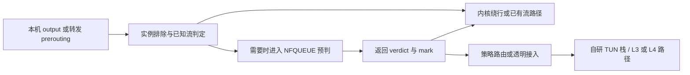

# Linux 网络集成设计

状态：Linux 宿主网络集成设计，核心原则见 [多平台集成与运维原则](../../design-principles/platform-and-operations.md)。

## 能力边界

建议 Linux 适配层管理 TUN、rtnetlink 路由和规则、nftables、NFQUEUE、出口绑定、网络变化事件及可选 resolved D-Bus 集成。自研 TCP/IP 核心只依赖稳定的包与事件契约，Linux 服务实现不进入通用协议状态机。

通用能力、原生/宿主提供者、句柄与回调生命周期遵循[平台抽象](../abstraction.md)。Linux 后端不反向依赖具体代理协议，托管设备模式按明确责任分配避免重复修改宿主网络。

Corosio 负责异步协调，新增 Netlink/NFQUEUE/系统通知描述符的接入方式需实验确定。动态能力接口优先 ngcpp/proxy，可失败操作返回 `expected`。本轮没有选定 nftables/Netlink/D-Bus 第三方库，也没有更改自研 TLS 与密码依赖边界。

## 自动透明分流

建议分为普通 L4 代理、TUN 接入及 TUN 配合 nftables 自动分流三个场景，各自报告实际启用能力；不将 nftables 或 TUN 权限设为普通代理的必需条件。

上图是责任划分，不是最终 hook 顺序或可直接安装的规则。nftables 分流不等同于将所有业务规则下推内核；域名、嗅探、用户和动态状态可能只能在用户态确定。不能确定时延后完整判定。

## nftables 与策略路由

- 按实例管理独立表、链和集合，记录链 hook、priority、对象标识与引用关系；IPv4/IPv6 行为分别验证。
- 本机出口、TUN 返回、回复方向、本地地址、代理服务器地址及 DNS 引导路径显式排除，避免重复接管。
- packet mark 与 conntrack mark 分别建模，声明占用的位或值，检查与其他服务和策略路由的冲突。不能默认覆盖已有 mark。
- 大地址集合采用集合/区间表达，网络变化时更新实际受影响对象，不逐条生成无限增长的规则链。
- NFQUEUE 仅在需要用户态预判的阶段使用，明确队列深度、包复制长度、GSO/分片处理、判定超时和用户态消费者退出时的行为。
- `bypass`、拒绝、丢弃、进入代理和信息不足分别表达；内核绕行与 direct 代理出口分别跟踪统计语义。

不能假设 NFQUEUE 队列满、未监听、规则不支持时存在统一的默认回退。具体 fail-open/fail-closed 策略需显式定义、验证并可诊断，不用静默降级掩盖接管失败。

优先研究结构化 Netlink 对象管理，避免用 shell 拼接每条规则。是否依赖库、如何编码请求和处理 ACK/扩展错误另行验证；诊断导出可以提供可读规则计划，不意味着执行任意 shell 文本。

## 配置变更与恢复

按“探测 → 计算计划 → 准备设备/消费者 → 分阶段提交 → 验证 → 宣布就绪”组织启动。只有消费者与返回路径可用后才激活接管规则，具体顺序由选定数据路径验证。

同一 nftables 批次的提交边界与路由、DNS、设备操作的边界不同，应维护已完成步骤及补偿动作。失败时回收本实例资源，并报告未回收项；不宣称整个 Linux 网络配置是单事务。

多实例需协调 TUN 名称、nft 表、fwmark、路由表/规则 priority、NFQUEUE 编号及监听端口。启动前检测冲突，不能仅通过 systemd `%i` 分开状态目录就认为网络资源已隔离。

正常停止撤销接管并清理资源，具体保留在途连接的行为另行设计。进程被 SIGKILL 时没有析构机会；下次启动应识别自身遗留对象，检查是否仍由活跃实例持有后再恢复或清理。禁止清空宿主整个 ruleset 或删除不明来源对象。

## 防火墙与容器共存

Nexus 对外部防火墙（如 Docker 网桥与 OpenWrt `fw4`）提供独立适配器，不直接假设通用 accept 规则能穿过所有后续链。

需区分 Docker 的后端和实际链结构、Podman、firewalld、OpenWrt fw4 与手写规则。仅对已验证组合声明支持；外部 ruleset 重建时按事件重新核对自身对象，处理事件丢失与 monitor 重连，避免持续重写和事件反馈环。

外部链中新增规则需有清楚的实例标识、精确匹配与撤销方式。若需要像 fw4 那样写 include 文件和触发外部重载，将文件与重载结果纳入同一操作记录，不能只跟踪内核对象。

## DNS 与网络变化

建议将出口选择、接口/地址/默认路由变化与 DNS 更新作为协同事件处理。首次启动无网络不等于配置永久无效，重连后应能恢复。

如接入 systemd-resolved，区分读取系统解析环境和修改 Nexus 所有链路的 DNS/域设置，保留链路所有权，不盲目覆盖其他网络管理器的更改。resolved D-Bus 的链路 DNS、域与撤销接口见[官方接口](https://www.freedesktop.org/software/systemd/man/latest/org.freedesktop.resolve1.html)。

不默认替代系统 resolved，不将链路 DNS 配置等同于保证无 DNS 泄漏；还需验证应用直连 DNS、IPv6、分流域、代理服务器引导解析及其他 VPN 并存。

## Linux 性能优化

在正确接管与回收后，逐项实验多队列、GSO/GRO/校验和卸载、批量 I/O、原生 splice 和内核 bypass。记录生效的能力、进入比例、降级原因与 CPU/包，避免把某个开关等同于已经加速。

系统 FD 上限不替代连接和内存预算，不为追求吞吐自动修改全局 sysctl。需要调整的参数必须与实际队列、conntrack、socket 缓冲及工作负载一起测量。

验收见 [Linux 验证计划](../../planning/linux-validation.md)，工程要点见 [多平台集成与运维原则](../../design-principles/platform-and-operations.md)。
